# Jerry Character Bible Review Gallery v001

Robbie review cleaned on 2026-05-19. The approved and support images have been copied into:

`assets/characters/jerry/character-bible-v001/references/`

## Approved Primary Body Look

These define the main Jerry body target.

### JB-001 - approved - primary body

### JB-002 - approved - primary body
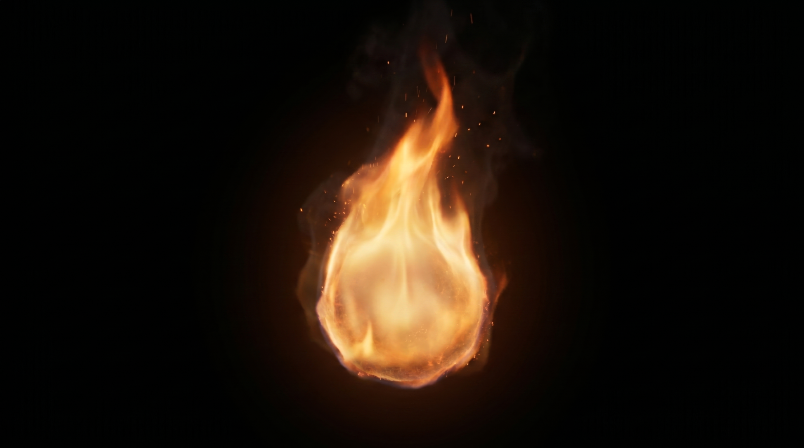

### JB-003 - approved - primary body
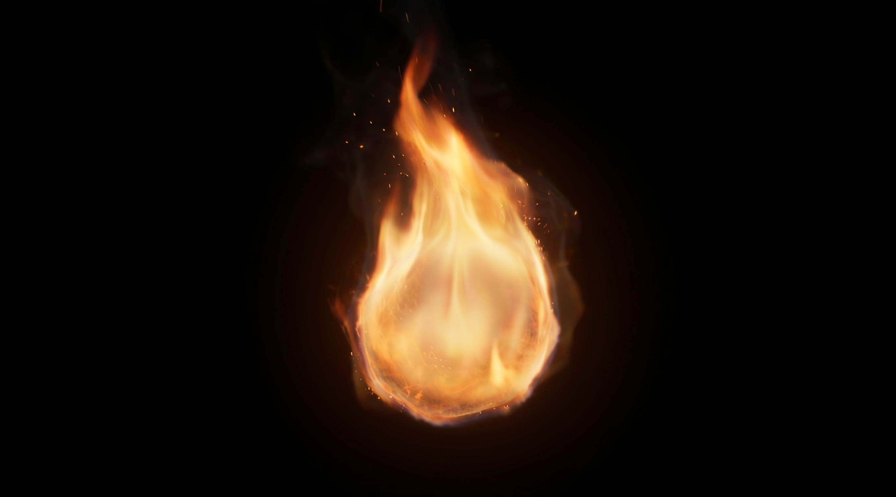

### JB-006 - approved - primary body
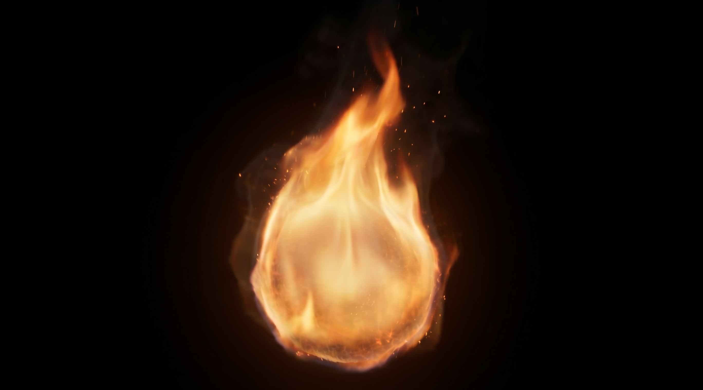

### JB-009 - approved - primary body

### JB-010 - approved - primary body
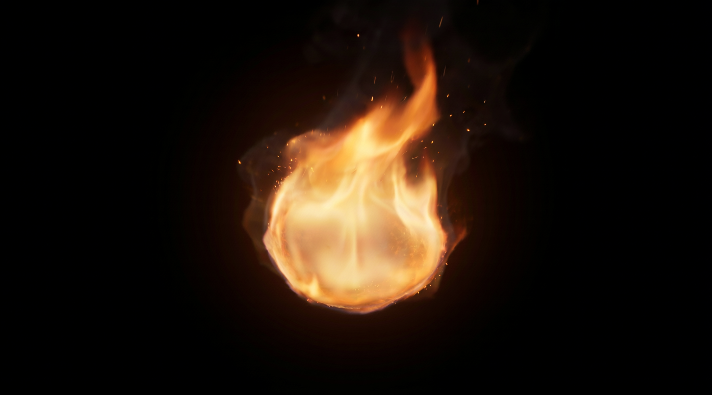

## Approved Motion And Pose

These are approved for Jerry's movement language.

### JB-004 - approved - motion

### JB-005 - approved - motion
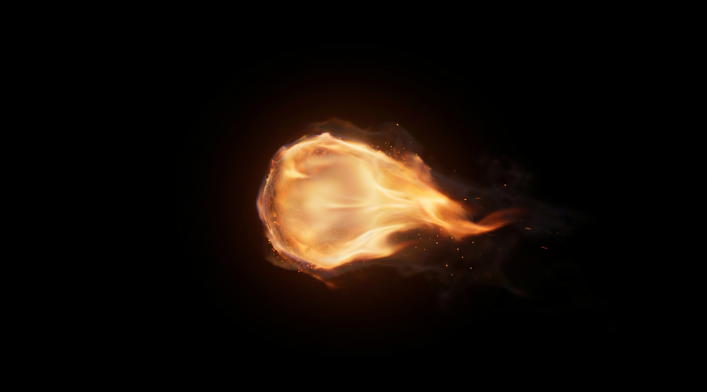

### JB-011 - approved - motion
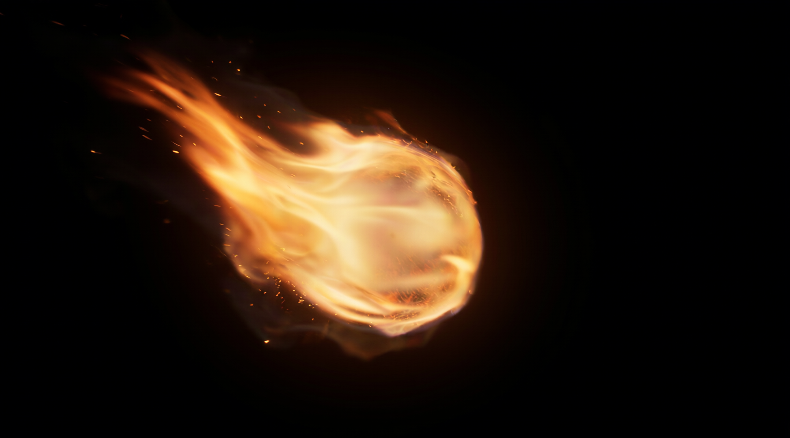

### JB-013 - approved - motion
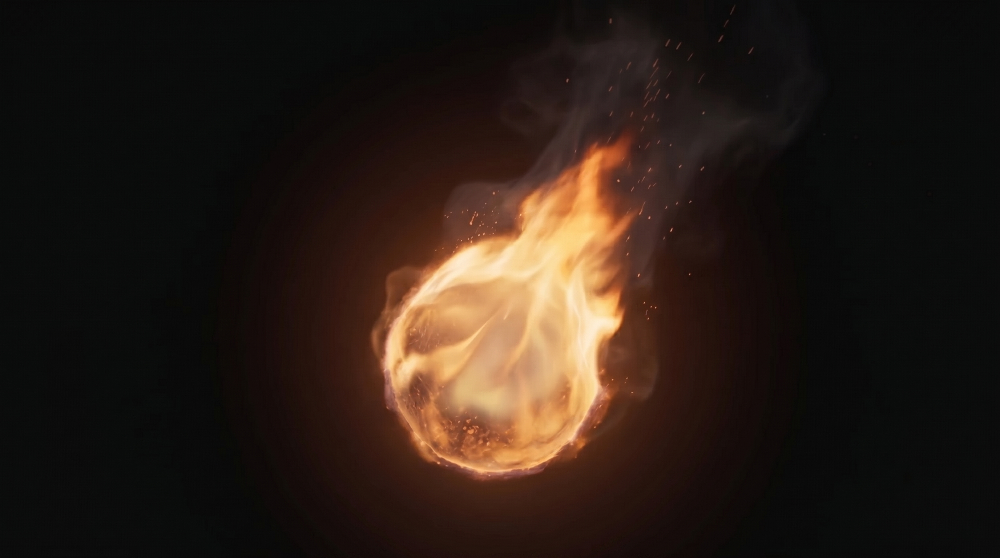

## Secondary / Training Only

These are useful support references, but should not drive the primary Jerry look.

### JB-007 - secondary - Scene 12 / comeback reference
Do not use as a primary reference image. Good as a secondary source and for Scene 12 when Jerry comes back to life.

### JB-008 - secondary - angle/training reference
Interesting angle. Do not make Jerry normally upside down like this, but useful for AI training/reference variety.

## Approved Material Reference

### JB-012 - approved - material
Good material reference.

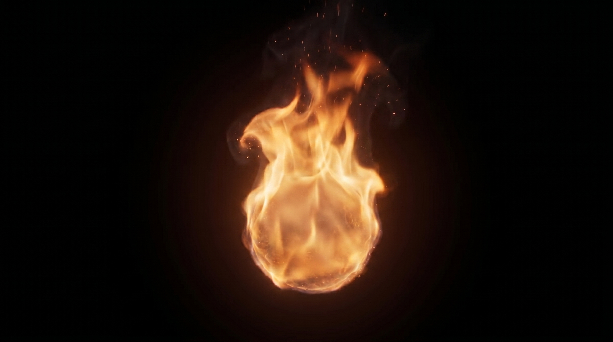

## Source Reference Only

These stay available for grounding against source renders, but should not drive final look generation by themselves.

### JB-018 - source reference only

### JB-019 - source reference only
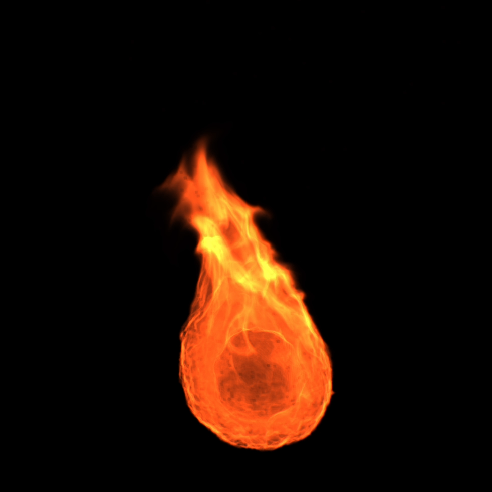

### JB-020 - source reference only

### JB-021 - source reference only
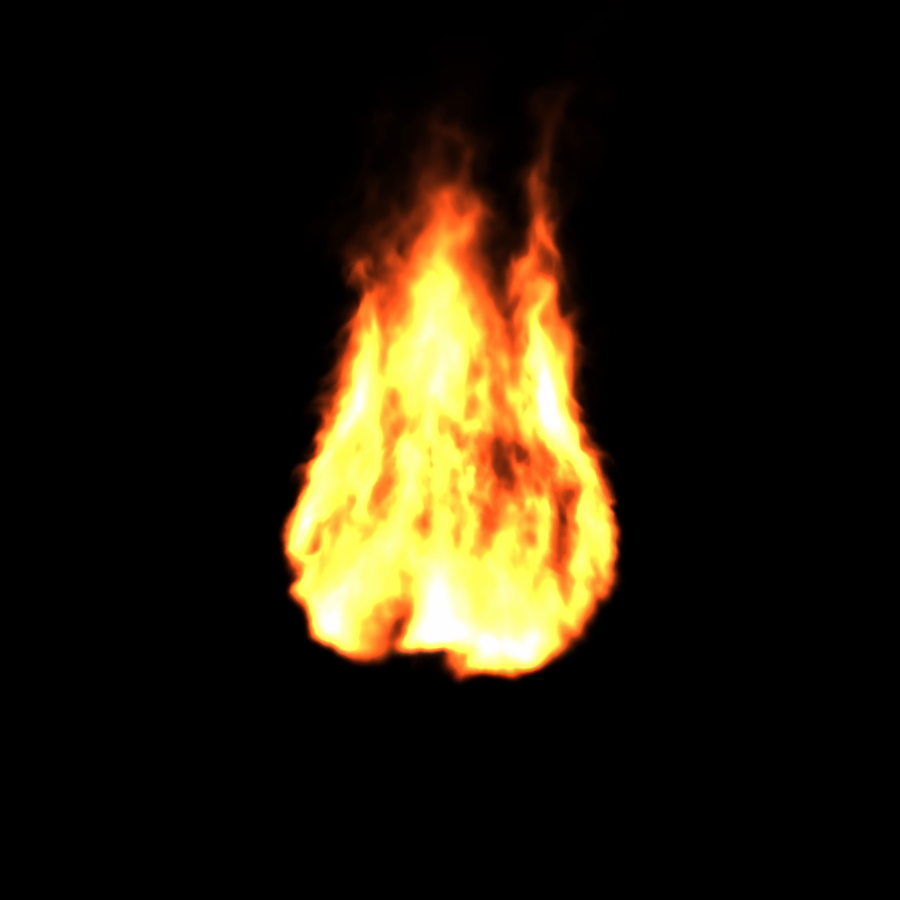

## Performance And Face-Layer Reference Only

These references may include temporary facial marks. They are 2D animation/performance references only. The base-body render remains face-free.

### JB-022 - 2D animation reference only

### JB-023 - 2D animation reference only

### JB-024 - 2D animation reference only
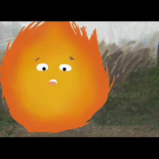

### JB-025 - 2D animation reference only

### JB-026 - 2D animation reference only

### JB-027 - 2D animation reference only
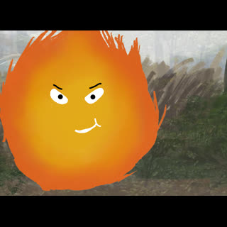

### JB-028 - 2D animation reference only
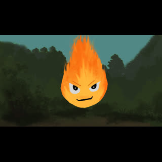

### JB-029 - 2D animation reference only
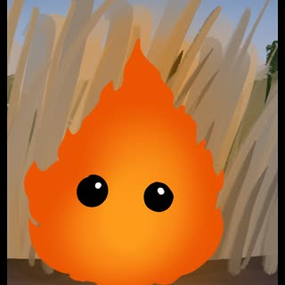

### JB-030 - 2D animation reference only

## Excluded

- `JB-014`: remove as reference because the ball shape is less teardrop-like.
- `JB-015`: texture not quite right.
- `JB-016`: texture not quite right.
- `JB-017`: too blurry.
