# Tom Approval Review Gallery v001

Date: 2026-05-21

Status: review only. These images are candidates, not approved bible references.

Use `approval_manifest.tsv` to record decisions.

## Source / Context

### TB-001 - Tom X Sheet, Performance Ref Only

Note: this source currently appears as black blocked silhouettes.

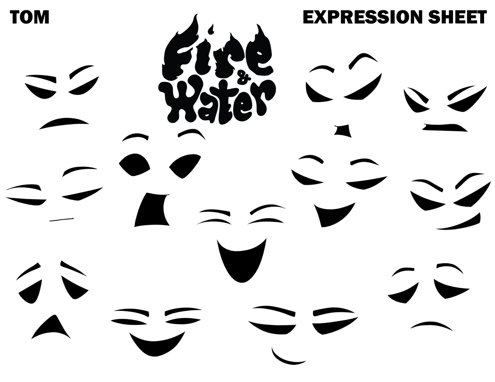 # no facial animations for the moment but maybe as reference for later not part of the core images

### TB-002 - Shot 8H Comp Contact, Source Ref Only

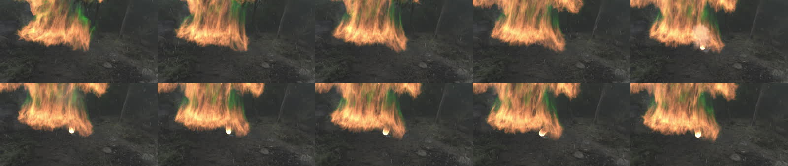 # good but we want single images only not contact sheets

### TB-003 - Shot 8L Animation Contact, Source Ref Only

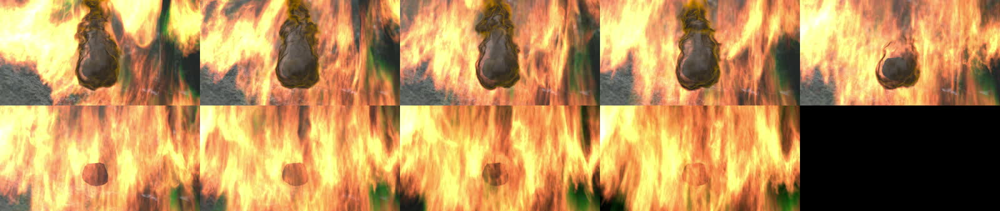 # good but we want single images only not contact sheets

### TB-004 - Shot 8L Comp Contact, Source Ref Only

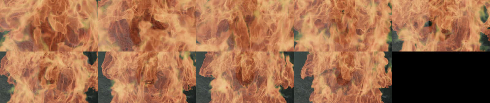 # good but we want single images only not contact sheets

## Primary Body Candidates

### TB-005 - Shot 8H Tom DN Frame 0020

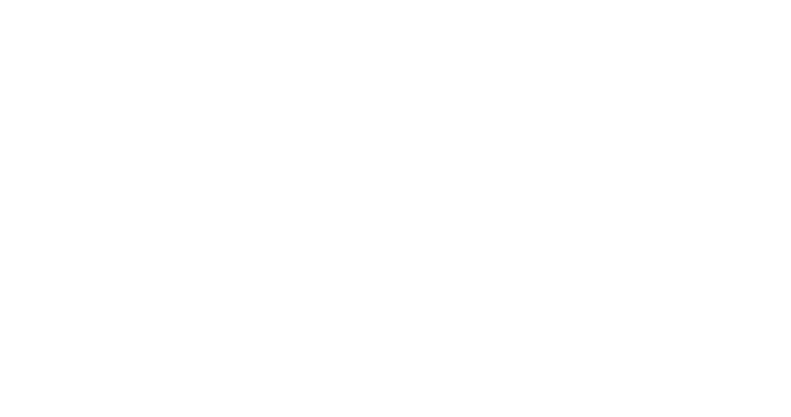 # blank frame - not useful

### TB-006 - Shot 8H Tom DN Frame 0040

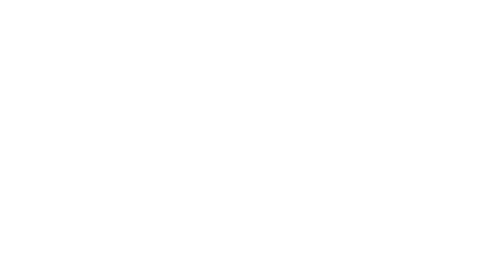 #blank frame - not useful

### TB-007 - Shot 8H Tom DN Frame 0060

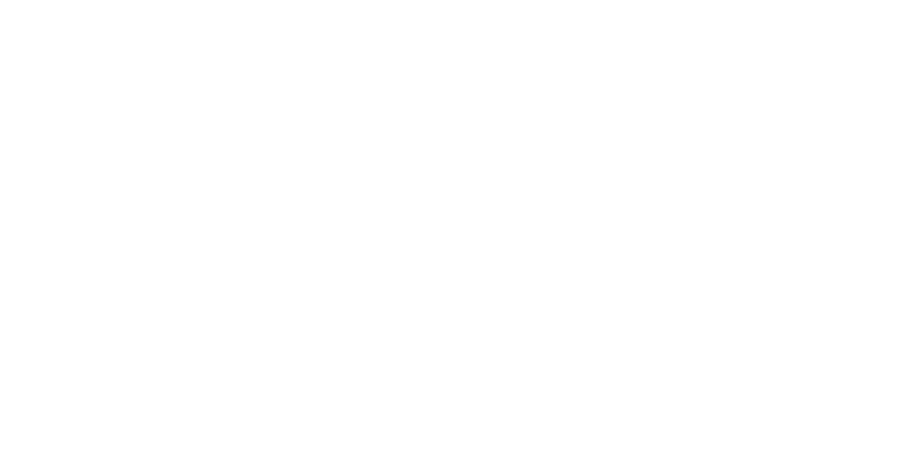 # blank frame - not useful

### TB-010 - Shot 8G Combined Tom Frame 0010

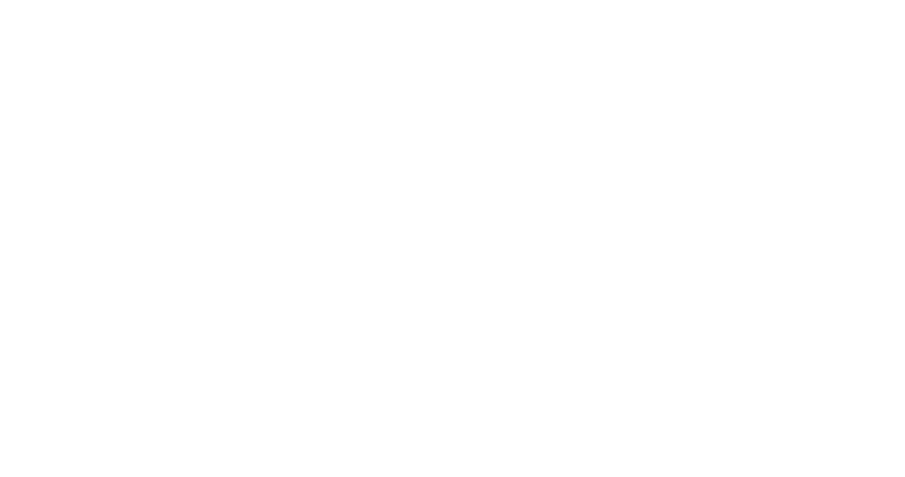 # blank frame - not useful

### TB-013 - Shot 8L Tom DN Frame 0040

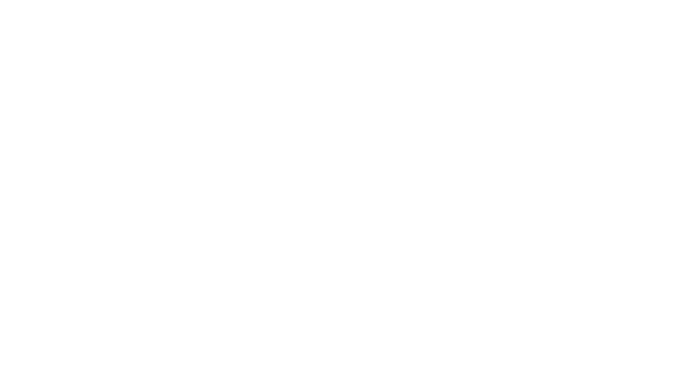# blank frame - not useful

## Motion / Pose Candidates

### TB-008 - Shot 8H Tom DN Frame 0080

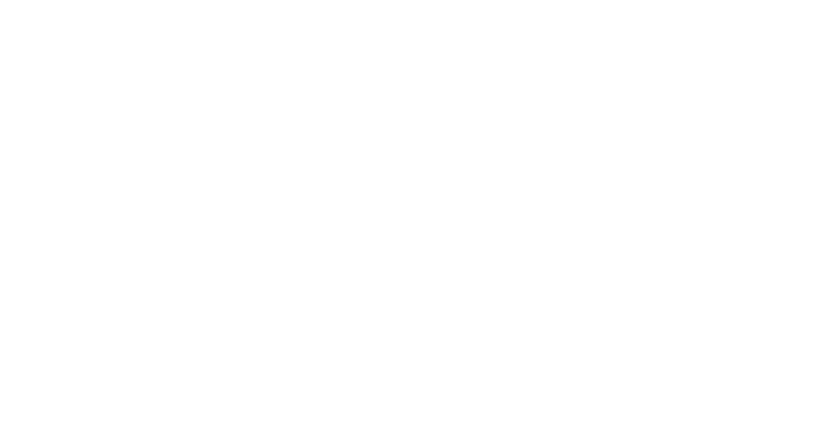# blank frame - not useful# blank frame - not useful

### TB-009 - Shot 8H Tom DN Frame 0100

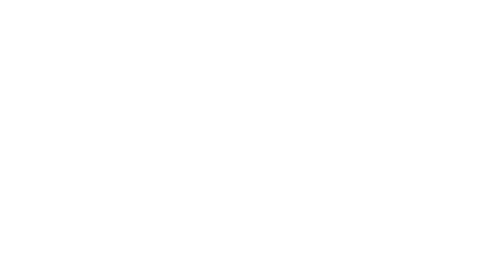 # blank frame - not useful

### TB-011 - Shot 8G Combined Tom Frame 0025

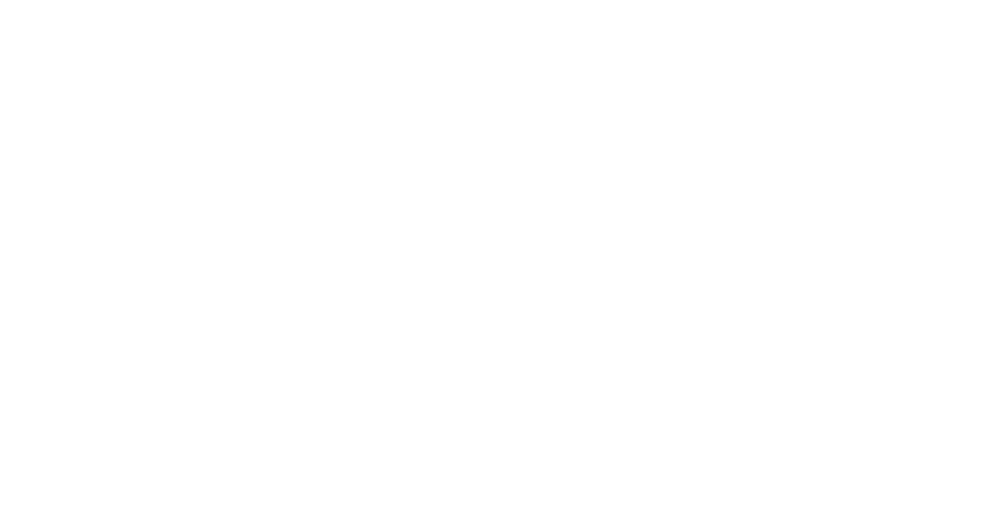 # blank frame - not useful

### TB-014 - Shot 8L Tom DN Frame 0060

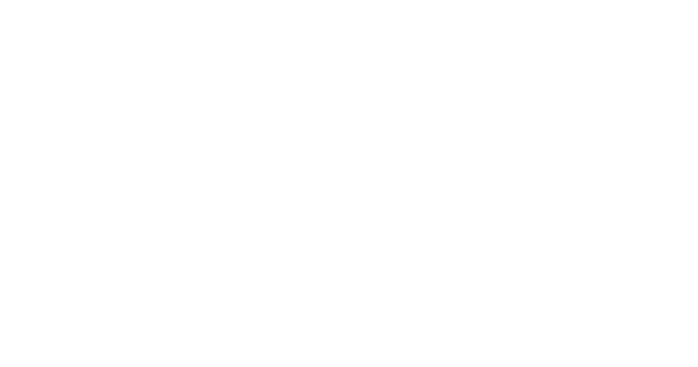 # blank frame - not useful

## Material Candidates

### TB-012 - Shot 8G Combined Tom Frame 0040

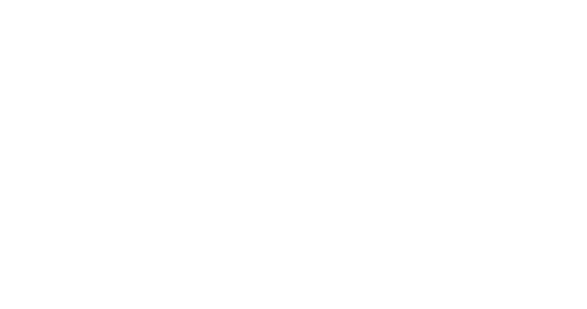 # blank frame - not useful

### TB-015 - Shot 8L Big Fire Frame 0040

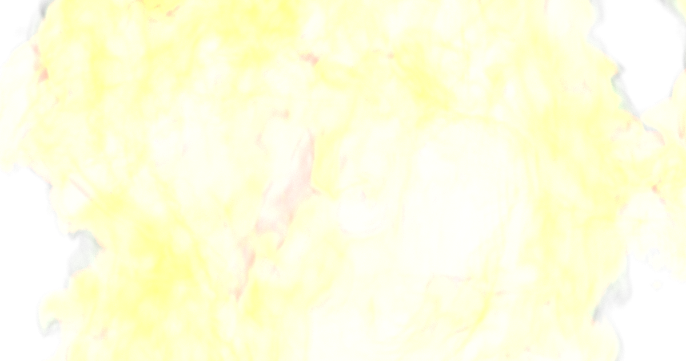 # good for material but maybe we can get some better images

### TB-016 - Shot 8L Big Fire Frame 0060

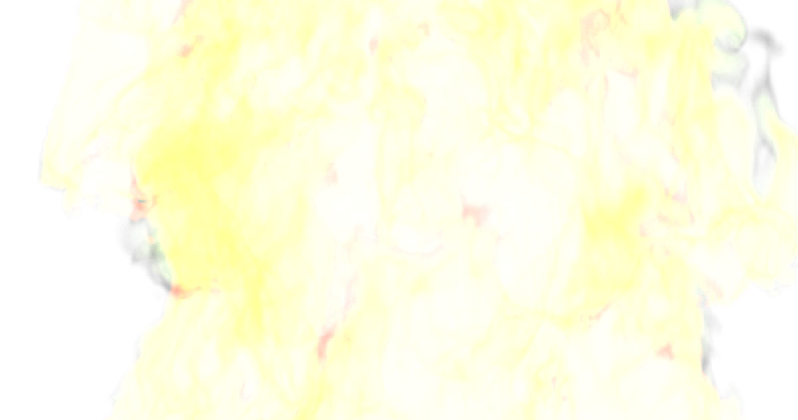 #good for material but maybe we can get some better images

## Review Prompts

- Which `TB-###` items feel like Tom's actual body identity?
- Which items are only material/fire behavior references?
- Which items are useful for scale/context but should not train or define Tom?
- Which items should be rejected because they are too generic, too busy, too close to Jerry, or not readable?
