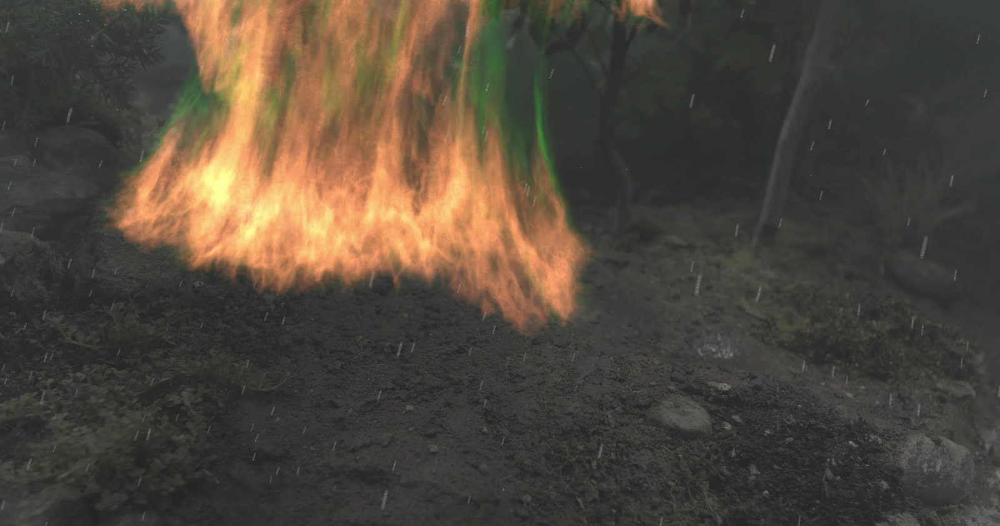
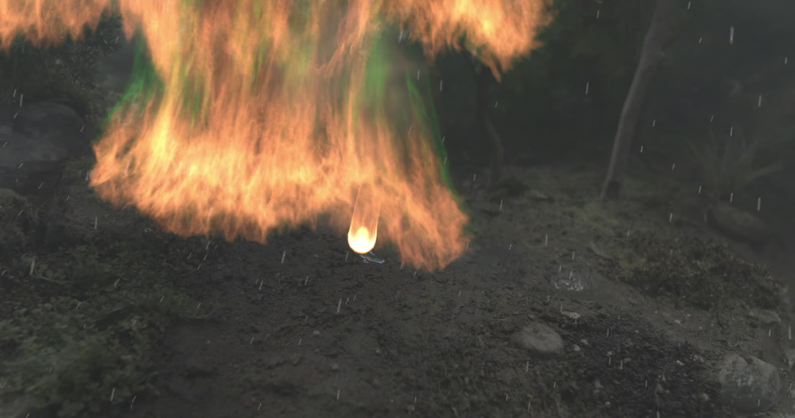
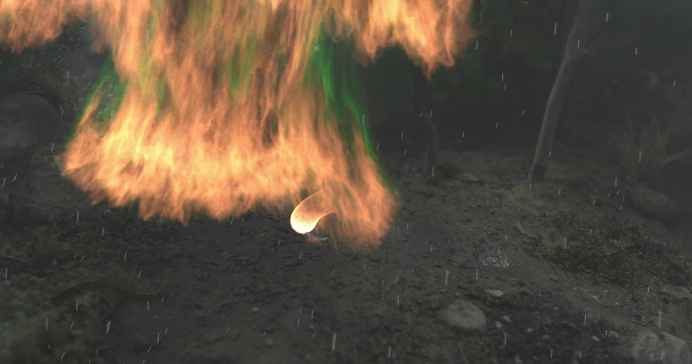
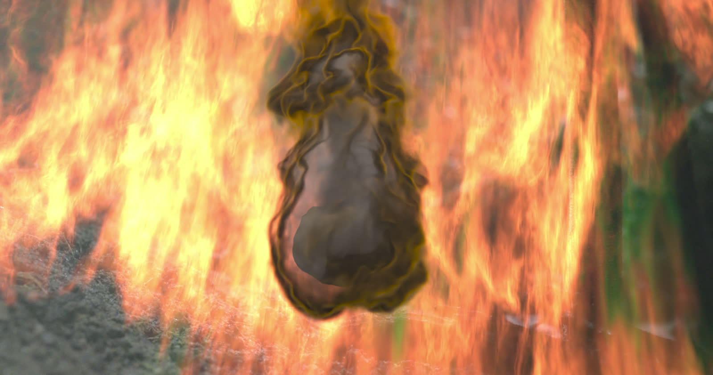
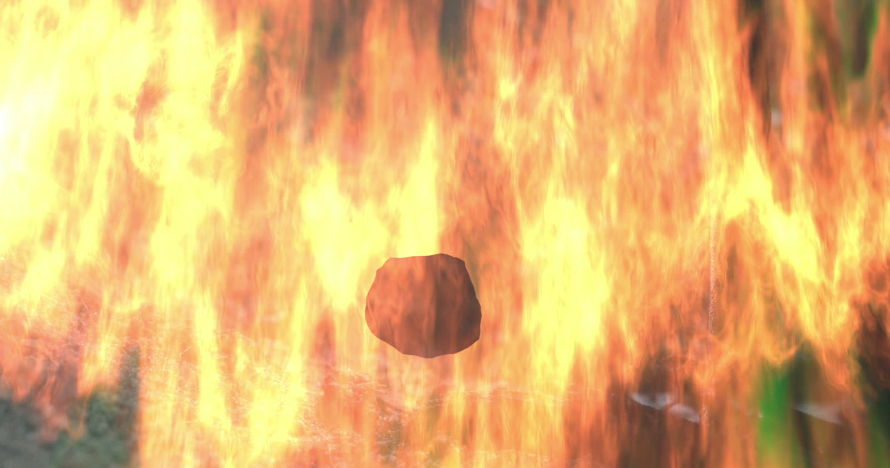
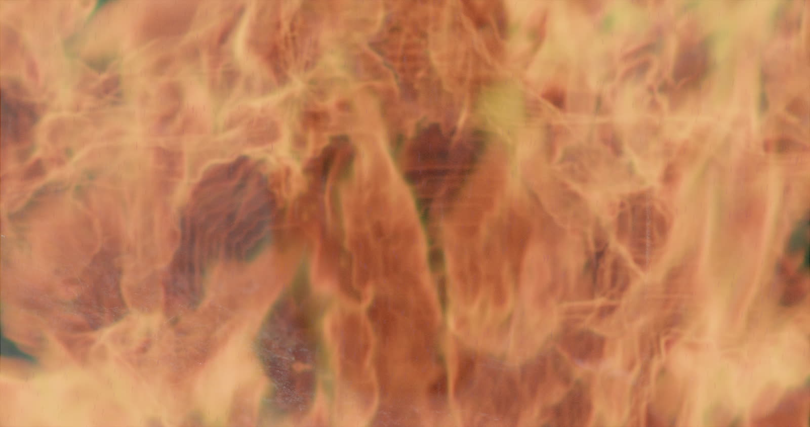
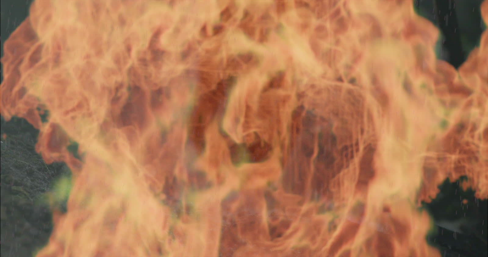
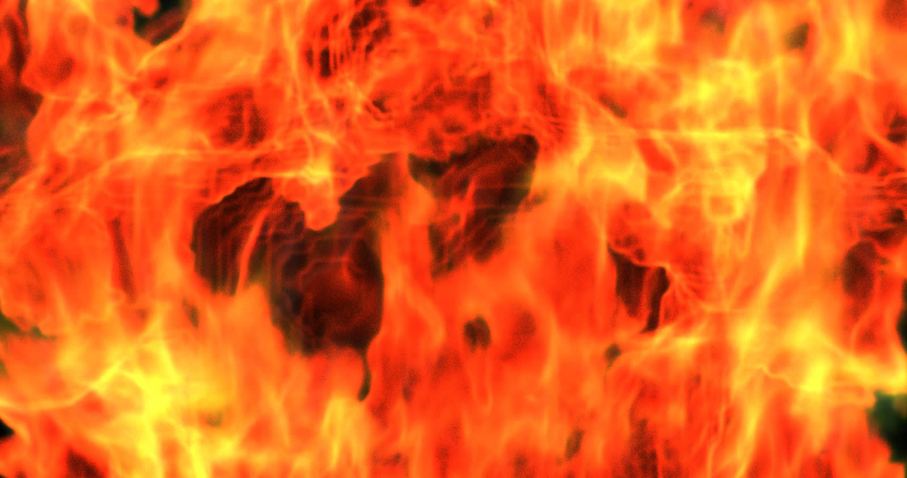
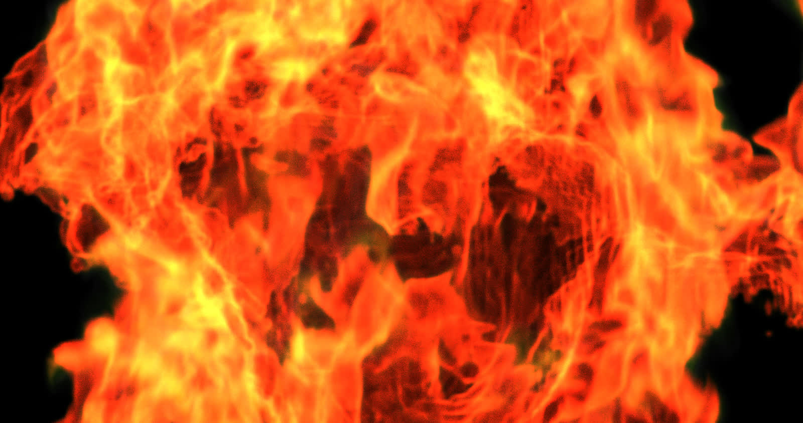
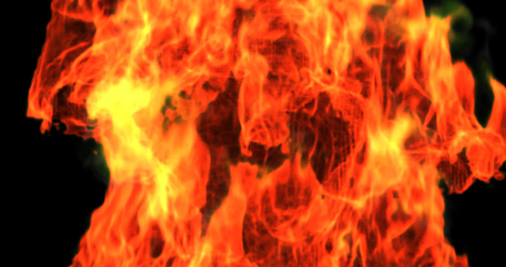

# Tom Approval Review Gallery v002

Date: 2026-05-21

Status: review only. These images are candidates, not approved bible references.

This replaces `v001` for active review. `v001` remains as a record of comments.

Use `approval_manifest.tsv` to record decisions.

## Source Stills

### TB2-001 - Shot 8H Comp Frame 0024

Single still from the Shot 8H comp. Use for Tom scale, plate integration, and interaction context.

 # this is good. If we get one without him cropped that would be great. I see keep this for now

### TB2-002 - Shot 8H Comp Frame 0060

Single still from the Shot 8H comp. Good for Tom/Sally scale and context.

 # Tom is not bad here

### TB2-003 - Shot 8H Comp Frame 0096

Single still from the Shot 8H comp.

 # ok. would like him more in frame if possible

### TB2-004 - Shot 8L Animation Frame 0016

Single still from the Shot 8L animation/reference movie.

 # This has TOm in the background but jerry as a coal is a litttle too presetn. I would prob reject this one

### TB2-005 - Shot 8L Animation Frame 0040

Single still from the Shot 8L animation/reference movie.

 # same as previous comment

### TB2-006 - Shot 8L Comp Frame 0016

Single still from the Shot 8L comp export.

 # This is good for material maybe but not as a an overall reference for tom

### TB2-007 - Shot 8L Comp Frame 0040

Single still from the Shot 8L comp export.

 # same as previous comment

## Material Candidates

### TB2-008 - Shot 8L Big Fire Frame 0020

Flattened JPG from the big-fire EXR sequence.

 # bad image

### TB2-009 - Shot 8L Big Fire Frame 0040

Flattened JPG from the big-fire EXR sequence. Replaces the useful-but-alpha-prone direction from v001 `TB-015`.

 # bad reference

### TB2-010 - Shot 8L Big Fire Frame 0060

Flattened JPG from the big-fire EXR sequence. Replaces the useful-but-alpha-prone direction from v001 `TB-016`.

 # bad reference

## Review Prompts

- Which `TB2-###` items are worth keeping for Tom?
- Which are only material/fire behavior references?
- Which are source-only context and should not become character body anchors?
- Which should be rejected?
