# Tom Approval Review Gallery v003

Date: 2026-05-21

Status: review only. These images are candidates, not approved bible references.

This is a supplemental pass after v002 comments. It focuses on finding Tom more fully in frame.

Use `approval_manifest.tsv` to record decisions.

## Fuller Tom Source Stills

### TB3-001 - Shot 8A Tom Fire v02 Frame 0007

Fuller Tom source still, less cropped than the Shot 8H candidates.

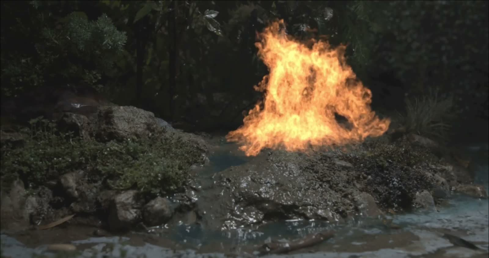

### TB3-002 - Shot 8A Tom Fire v02 Frame 0014

Fuller Tom source still with lateral/beckoning shape.

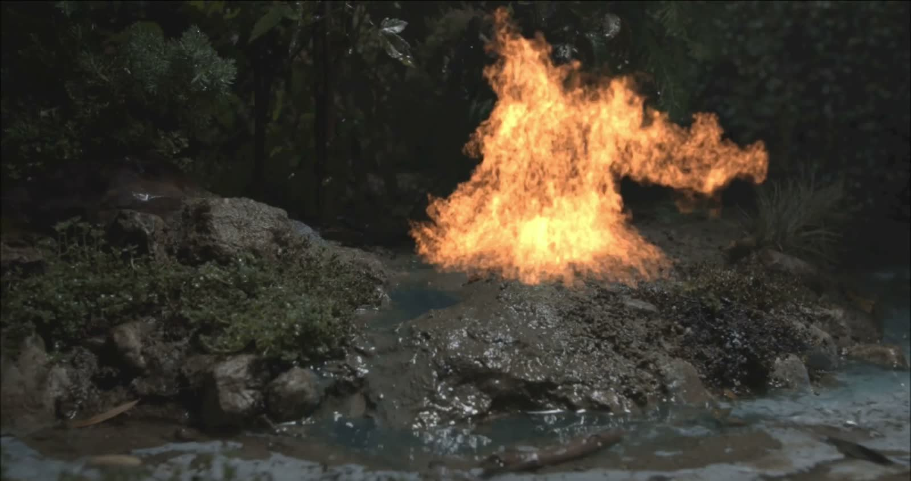

### TB3-003 - Shot 8A Tom Fire v02 Frame 0021

Fuller Tom source still with stronger action silhouette.

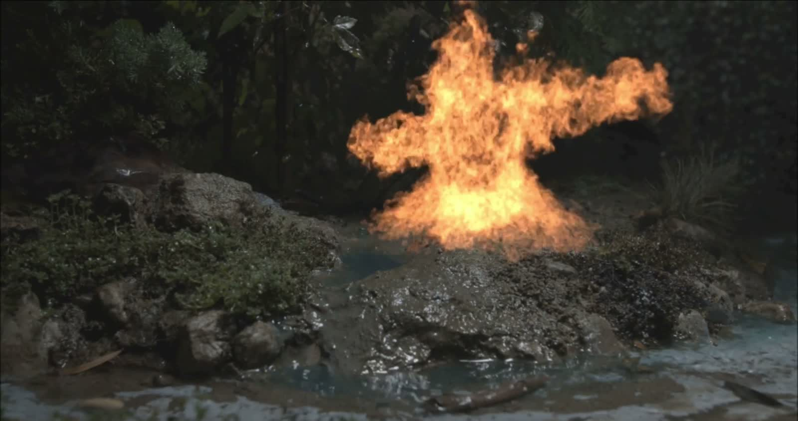

### TB3-004 - Shot 8A Tom Fire v02 Frame 0028

Fuller Tom source still with broad, aggressive shape.

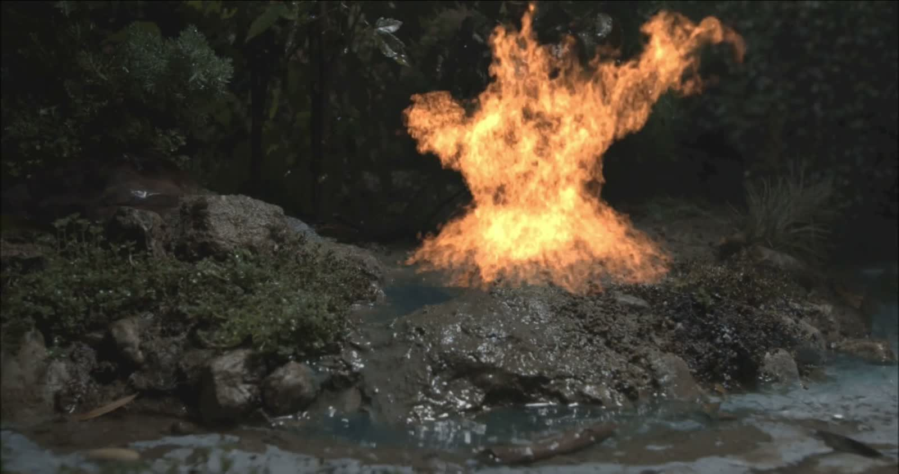

### TB3-005 - Shot 8A Tom Fire v02 Frame 0035

Possible primary body/look anchor.

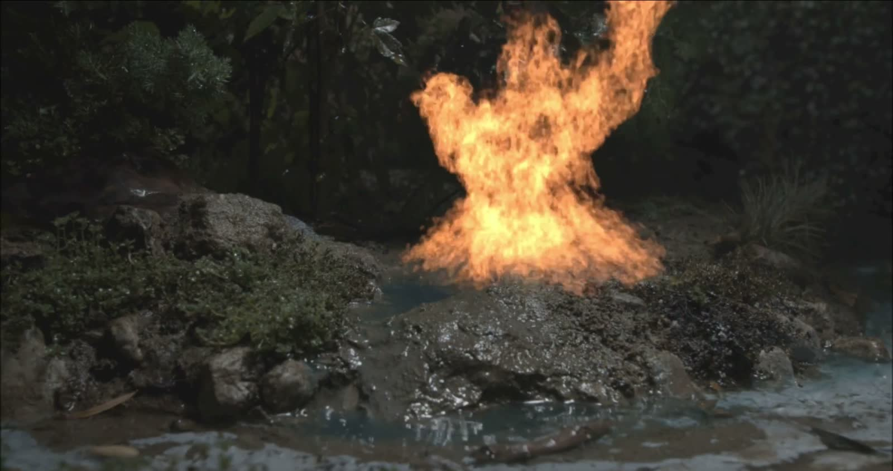

### TB3-006 - Shot 8A Tom Fire v02 Frame 0049

Upright/full-body read.

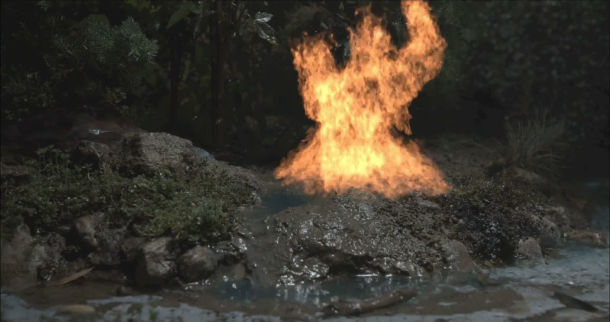

### TB3-007 - Shot 8A Tom Fire v02 Frame 0063

Upright/full-body read.

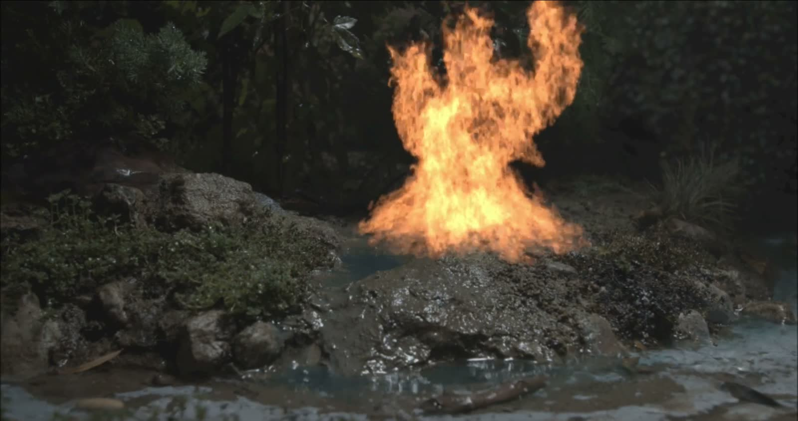

## Material References

### TB3-008 - Shot 6 Tom Green Tips Frame 0020

Material support only.

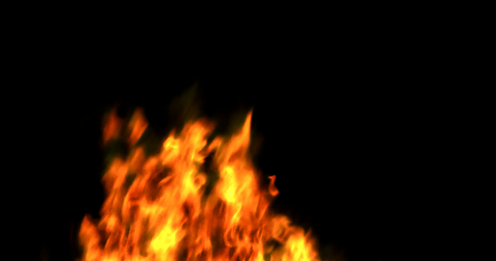

### TB3-009 - Shot 6 Tom Green Tips Frame 0050

Material support only.

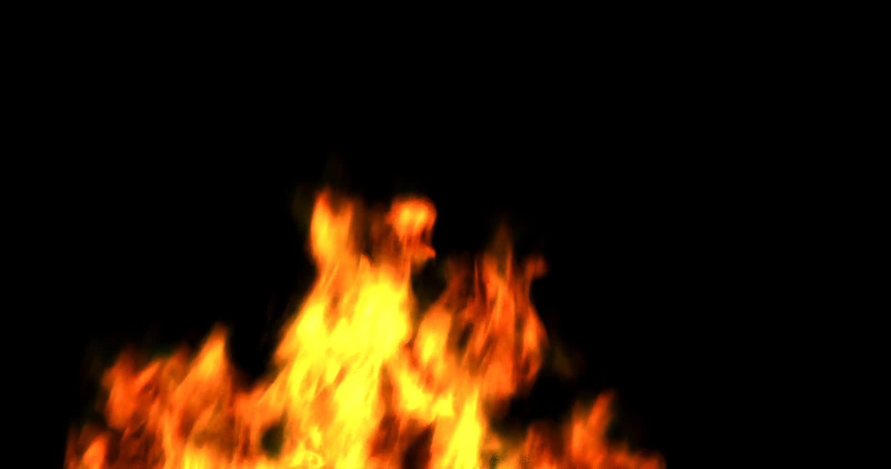

### TB3-010 - Shot 6 Tom Green Tips Frame 0080

Material support only.

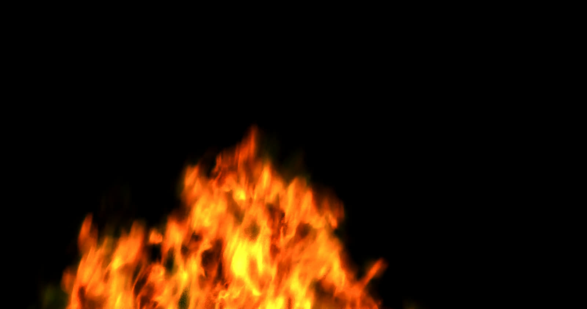

## Storyboard / Source References

### TB3-011 - Storyboard 8G Frame 0028

Source reference for action/composition only.

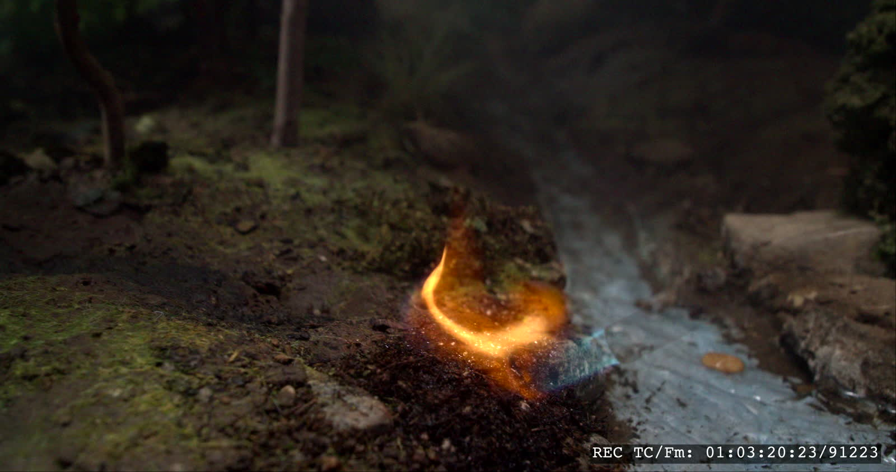 # not a good tom reference

### TB3-012 - Storyboard 8G Frame 0040

Source reference for action/composition only.

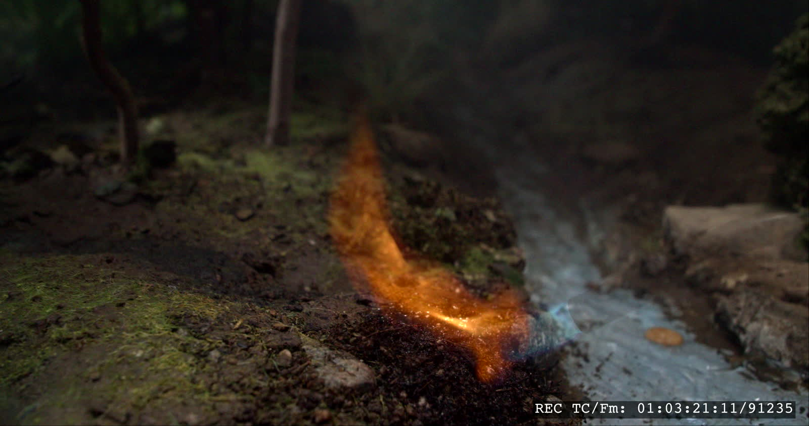 # not a good tom reference

## Review Prompts

- Which `TB3-###` items are worth keeping for Tom?
- Are any Shot 8A stills strong enough as primary Tom body/look anchors?
- Which are only motion or material support?
- Which should be rejected?
