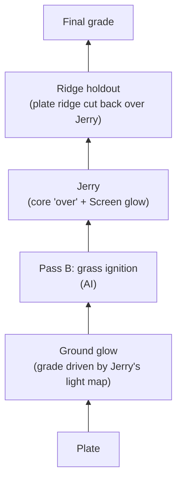

**Created:** 2026-11-02
**Updated:** 2026-11-04

# Shot004 Fire Jump Plan

How shot 004 is built: the layers, the current method for each, and what comes next. Shot index and decisions: `README.md`. Every generation run is in the pass logs (`pass-a_jerry_log.md`, `pass-b_grassfire_log.md`); comp versions in `comp_log.md`. This plan holds only current methods; stopped methods are summarised with their run IDs.

## Inputs

| Layer | File | Status |
|---|---|---|
| Plate | `assets/elements/by-shot/shot004_fire-jump/plates/FW_test_scene.mp4` (4096×2160, 24 fps, 84 frames, 10-bit) | Staged test plate; its provenance relative to the original `4 base plate.mov` is unverified. |
| Jerry (Pass A) | `assets/elements/by-shot/shot004_fire-jump/benchmark/shot004_fire-jump_mick13-skyreels_graymask-promptv3-jb010-str125-lenovo_seed1218565630_v001.mp4` (run 8, 912×512, 24 fps, 81 frames) | Current best. Too large (see below). |
| Houdini fire (reference) | `assets/elements/by-shot/shot004_fire-jump/fire/shot004_fire-jump_ren-small-fire6_source_v001.mov` (decodes 1920×1014, covers the whole plate) | Motion source for Pass A. |
| Grass fire (reference only) | `ren_grassfire_cpu..mov` on the NAS backup | Not restored. |
| Delivered comp (reference) | `assets/elements/by-shot/shot004_fire-jump/comps/shot004_fire-jump_comp-houdini-delivered-v031_1920x1080_v001.mp4` (1920×1080, 24 fps, 84 frames) | Local copy, file-dated 2026-10-08; its relation to the NAS `Shot4 V031-1.mov` is unverified. Ignition timing below. |
| Comp (Blender) | `assets/elements/by-shot/shot004_fire-jump/comps/shot004_fire-jump_comp-blender_run8-passb-s3_v002.blend` | v002, 2026-11-04 (`comp_log.md`, `s004-c-003`); v001 without Pass B beside it. |

Placing a Mick 1.3 512p clip on the plate scaled to 1920×1014: scale ×2.0192 to 1842×1034, crop 10 px off the top, place at x +39.

## Layer Stack



Every layer is a separate input or node, so Jerry, the grass fire, or the glow can be swapped or regenerated without rebuilding the rest (the shot plan's core rule).

## Layers: method and status

### Jerry (Pass A element)

#### State (as of 2026-11-04)

The Pass A candidate is Mickmumpitz 1.3 SkyReels (VACE × SkyReels merge),
run 9: gray-in-mask driving video/mask, prompt v3, `JB-001` + `JB-010`
references, `vace_strength` 1.25, Lenovo LoRA, NAG on with face negatives,
seed `1218565630`, 512p, on the rebuilt `EU-RO-1` volume (L4). It passes
all three checks (trajectory, look, black) and reproduces the look of
run 8/8r closely, with slightly fewer face-like dark patches in the
Blender comp. Full history: `shots/shot004_fire-jump/pass-a_jerry_log.md`
(`s004-a-001` through `s004-a-023`).

Not yet approved: James has not signed off on run 9's look as final.
Jerry is 20–50% larger than the Houdini fire at 512p; a smaller,
rounded guide (6 px growth, rounded top, post-landing growth damped to
1.25×, built by `scripts/build_shot004_guide.py`) exists as a candidate
fix and is awaiting approval and a rerun. 720p has been deferred behind
that approval, since resolution changes count as a new sample needing
its own replication, and a kept 512p clip's embedded workflow/prompt
lets it be rerun at 720p later without redoing the lower-res work.

What's next: approval of the smaller guide, then rerun run 9's settings against it (on an L4, to compare with runs 8r and 9), then decide on 720p. Against the new Pass B fire, Jerry's smooth CG texture does not match the photographic grass fire (James, 2026-11-04, `comp_log.md` `s004-c-003`); the regeneration with the smaller guide is the place to address it, alongside comp settings.

#### The job and success criteria

Pass A only, until one workflow passes. Motion comes from the Houdini
fire on black; look comes from `JB-001`; background stays black so the
result can be screened or added over the plate. The plate itself is not
an input to this test. Do not promote a run to full length or to grass
ignition until it passes Pass A; do not spend cloud credits on a tool
that cannot take the motion clip.

A run passes when, watching the start, mid-jump, and landing:
trajectory matches the Houdini centroid (drift past ~10% of frame width
fails), look reads as the `JB-001` still (not the rough Houdini blob),
background stays near black (`≤2/255` away from the flame), and there
are no drawn face features anywhere in the clip. Cost (Pod minutes or
API credits) is recorded but is not a pass/fail gate. A setting passes
when at least 2 of 3 seeds pass all three checks; it is dead when 3
seeds fail the same check. A resolution change is treated as a new
sample that also needs its own replication.

#### Frozen inputs that still apply

- Motion: `assets/elements/by-shot/shot004_fire-jump/fire/shot004_ren-small-fire6_control_832x448_81f_v001.mp4`. Do not swap for a prettier jump; the Blender Jerry rig is a separate character test, not this driver, until a scored row replaces the Houdini clip.
- Look: `JB-001_upright-compact-idle.png` on the volume `input/`. `JB-010` only as a second reference, not a swap; the Blender r09 still is not approved.
- Plate: kept out of Pass A entirely (`FW_test_scene` and the 49-frame proxy are not inputs here).
- Short tests use the first 17 frames (`4n+1`); a 4-second cloud test may use the already-made 96-frame padded clip.

#### Promote rules

A winner is a short clip that passes all three checks (2-of-3 seeds).
Only then: rerun that setup at full length, comp it over the plate with
Screen or Add, and start Pass B as its own element (grass ignition and
ground glow, masked, not baked into the character pass). Pass B reuses
the same method: frozen inputs, one knob per run, its own checks.

#### Still open / still blocked

- Local stock-VACE knobs (`WanVaceToVideo`) are closed: strength 1 copied the Houdini fire, strength 0.5 smeared the path and still missed `JB-001`, and a white-mask control video was drawn as gray smoke. Do not queue 0.35, 0.7, or another mask tweak on that node.
- Wan 2.7 Video Edit tuning is closed (Stage 1, 2026-10-18): one good run (seed `2126129005`) out of four misses the 2-of-3 rule, and seed-locked one-knob A/B does not isolate a change on this tool. Keep `shot004_fire-jump_wan27-videoedit_seed2126129005_v001.mp4` as the paid fallback element if the local setup fails later. It renders at 30 fps/1280×720 from the 24 fps/832×448 input; conform both before any comp. Alibaba rewrites the prompt by default (`prompt_extend`) and supports a `negative_prompt` the ComfyUI node does not expose.
- Kling Omni Edit and Kling Motion Control are scored and closed; do not retry either for this job.
- Do not test: Veo (no motion-video input), Kling Motion Control/other skeleton drivers (Jerry has no upper body), Seedance or Wan reference-to-video as the path lock (already failed that job, fine as a look study only), a new model just because a chatbot ranked it this week, or Pass B/4K/an 81-frame run before a 17-frame pass clears.
- Parked, not active: Wan-Alpha (text-to-video only, moved to Pass B as a loose flame/smoke source with real alpha); Wan 2.7 first/last-frame I2V (locks start/landing only, lower odds than an I2V path-lock stage); Wan 2.7 reference-to-video and Seedance reference (look studies only, already failed as path lock).
- Unstarted stages, open only if the current Mick 1.3 recipe fails after the smaller guide: Stage 3 image-to-video with a drawn path (ATI, Wan-Move, Time-to-Move) and Stage 4, training a Jerry LoRA. Both still require building their own derived inputs (a frame-0-composited still for Stage 2/3, a Houdini centroid JSON for Stage 3) before use.
- Third-party prices (Luma, Runway) were looked up 2026-10-17; confirm before queuing if that path reopens.

#### Closed branches

- VACE all-in-one on plate + screen blend — closed 2026-10-08 (`s004-a-001`).
- Local stock-VACE strength sweep and silhouette control — closed 2026-10-17 (`s004-a-002`, `s004-a-008`, `s004-a-009`).
- Kling Omni Edit frame-1 swap attempts — closed 2026-10-13 (`s004-a-005`, `s004-a-006`).
- Kling Motion Control — closed 2026-10-13, do not retry (`s004-a-007`).
- Wan 2.7 Video Edit tuning (Stage 1) — closed 2026-10-18, no winner, run 2 kept as paid fallback (`s004-a-010` through `s004-a-013`).
- VACE × SkyReels V3 R2V model-swap test (step 8) — closed 2026-10-19, superseded by the Mickmumpitz 1.3 ADV merge before it was ever run; no longer needed to answer the merge question.

### Ridge holdout

At the start position a dirt ridge in front of Jerry should hide part of him, as in the Houdini version. Cut the ridge out of the plate as a foreground matte (hand roto in Blender or Fusion, or AI segmentation such as SAM2) and layer it back over Jerry. Comp only. Done in Blender Comp v001 as a hand-placed mask.

### Ground glow

A comp effect, not AI. Take Jerry's element brightness, blur it heavily and tint it orange, and use that light map to brighten and warm the plate where the light falls, limited by a soft ground mask with a strength control. It moves and flickers with Jerry automatically. Upgrade path if it looks flat: a rough ground surface in Blender with a point light following Jerry's path, rendered as a light pass. Done in Blender Comp v001.

### Pass B: grass fire

What it must do: ignition starts where and when Jerry lands and spreads through the grass; most of the growth in flame comes from the grass catching; plate intact outside it.

#### State (as of 2026-11-04)

- **Method: first-last-frame video, comped as a layer.** A video model is given the clean plate at frame 25 (Jerry's landing, before ignition) as the first frame and a keyframe of the clump burning as the last frame, and invents the ignition and spread itself. Inputs (16:9 crop of the plate, x 128–3968, so the fire ends inside the picture): `scorch-contact/keyframes/shot004_grassfire_plate-full169_f025_1920x1080_v001.png` and `…_keyframe-k2_full169-platebg_1920x1080_v001.png` (`k2` around its flames, the plate outside, so the model does not regrade the frame). Graph: `workflows/comfyui/shot004-working/pass-b_grassfire/shot004_fire-jump_grassfire-flf_seedance20_v001.json` (Seedance 2.0 and Kling branches; ComfyUI partner API nodes, billed to the Comfy account, no GPU needed).
- **Comp:** `scripts/build_shot004_grassfire_layer.py` registers the clip onto the plate, retimes it (`--map`), keeps the fire light as a gain on the plate (the plate keeps its own texture) and takes the fire itself by a change matte inside a zone; `scripts/blender/shot004_comp_add_passb.py` puts it in the comp's Pass B slot. First result `s004-c-003`: works as a layer; soft at 480p.
- **Runs so far:** Seedance S1–S4 (`s004-b-018`–`020`, `022`): natural ignition and soft translucent flames; S2 fixed framing and regrade; with the same frames and seed, prompt timing words barely change the sample (S4 ≈ S3). Kling K1 (`s004-b-021`): 1080p, the most natural ignition (an ember line along the base), about 2× too slow.
- **Next:** comp Kling K1 like S3 and compare; pick generator and timing; one final run at full resolution (Seedance 1080p or 4K, which maps 1:1 onto the 16:9 crop, or Kling 1080p); retime in the comp. To change Seedance timing, change seed or duration, not the prompt.
- **Keyframes:** four Higgsfield edits of a plate frame by James's colleague (`scorch-contact/keyframes/`, README there); `k2` and `k4` are the closest to the goal.

#### Closed branches

- **Inpaint in the Mick 1.3 SkyReels graph** (`s004-b-001`–`017`, 2026-11-02 to 2026-11-03), stopped 2026-11-03 (James): Canny or gray inside a growing mask, strengths, references and keyframes inside the control. The fire always took the mask's shape (blob, dome, veil, glowing block). Inputs, candidates and setup: `pass-b_grassfire_log.md`, Setup reference.
- **Production grass-fire render as a guide** (`ren_grassfire_cpu`): parked until it is restored from the NAS.
- **MiniMax H3 inpaint:** parked; needs a ComfyUI update (the Pod runs 0.30.0) or Comfy Cloud.

## Comp

### Blender comp (tool in use)

`assets/elements/by-shot/shot004_fire-jump/comps/shot004_fire-jump_comp-blender_run8_v001.blend`, built by `scripts/blender/shot004_comp_build.py` (Blender 5.2.1). Rebuild with:

```sh
/Applications/Blender.app/Contents/MacOS/Blender -b --factory-startup \
  --python scripts/blender/shot004_comp_build.py -- assets/elements/by-shot/shot004_fire-jump/comps/shot004_fire-jump_comp-blender_run8_v001.blend
```

Rebuilding overwrites the file, so save hand edits as `_v002` first. Starting values are in the script's `LOOK` table; every tunable node is labelled `CTRL …`. 4096×2160 at 100%, frames 1–81 (Jerry's length; the plate has 84). Frame 1 is plate frame 0 and run 8 frame 0. Renders at about 2 s per frame on the M2 Pro GPU. To inspect one node, `scripts/blender/comp_tap.py` renders its output to EXR without saving the `.blend`.

| Layer | Nodes and starting values |
|---|---|
| Plate | Image node, movie, 84 frames. View transform Standard. |
| Ground glow | Jerry luminance → Fast Gaussian blur 900 px → map range 0–0.08 to 0–1 → × tint (1.0, 0.42, 0.10). Lit plate = plate × (1 + 2.5 × tint × light), limited by mask `ground_glow_limit` (row 500 down to the ridge, blurred 220 px), so the ridge's camera side stays dark. Raises the dirt under Jerry about 1.6–2.4× in red. |
| Pass B slot | A reroute (`Pass B in`) between the lit plate and Jerry; insert the grass ignition there. |
| Jerry | Run 8 → Transform ×4.3077 about the centre, bicubic (the 2026-11-01 placement math; the compositor centres images, so no offset) → saturation 1.2 → gain (1.25, 1.0, 0.78) → dark-patch fill (Lighten with a 140 px blur of itself, amount 1.0). Core over: matte = luminance blurred 30 px, mapped 0.03–0.22 to 0–1, × opacity 0.85. Then the same Jerry Screened on top, plus Fog Glow bloom (threshold 0.25, strength 0.6). |
| Ridge holdout | Mask `ridge_holdout`, a polygon along the defocused ridge top (rows 1778–1815 at 4096 wide, traced from the focus fall-off on frame 0; the camera is locked), blurred 28 px; mixes the lit plate back over Jerry. Hides the bottom ~90 px of Jerry at the start, frames 1–12. |
| Final grade | Neutral Color Balance → Group Output and Viewer. |

Blender 5.2 compositor details that cost time: the comp is `scene.compositing_node_group`, a node group with an Image output (there is no Composite node); the render percentage does not scale image inputs, so render at 100%; the Mix node clamps its factor to 0–1 unless `clamp_factor` is off; mask coordinates are x = px / width and y = (height / 2 − row) / width + 0.5.

### Fusion comp (reference only)

James asked for the same comp in DaVinci Resolve Studio's Fusion page to compare the two tools. Built by `scripts/resolve/shot004_comp_fusion.py` through Resolve's scripting interface (External scripting = Local), run with Resolve's bundled Python:

```sh
"/Applications/DaVinci Resolve/DaVinci Resolve.app/Contents/Applications/ResolvePython" \
  scripts/resolve/shot004_comp_fusion.py \
  --setting assets/elements/by-shot/shot004_fire-jump/comps/shot004_fire-jump_comp-fusion_run8_v001.setting \
  [--render-preview DIR --frames 0-80]
```

- **Where it lives:** Resolve project `FW_AI_shot004_comp` (Local Database; it was "New Project 4"), project and timeline at 4096×2160, 24 fps. Timeline `shot004_comp_v001` has the plate on V1 and run 8 on V2, turned into one Fusion clip, so MediaIn1 is the plate and MediaIn2 is Jerry. The node tree is also saved as `assets/elements/by-shot/shot004_fire-jump/comps/shot004_fire-jump_comp-fusion_run8_v001.setting`, which can be pasted into any comp; after pasting, wire MediaIn2 → `Jerry_Place`, MediaIn1 → `Glow_PlateXLight` (Background) and `Glow_Add` (Background), and `Final_Grade` → MediaOut1.
- **Project file in the repo:** `assets/elements/by-shot/shot004_fire-jump/comps/shot004_fire-jump_comp-fusion_run8_v001.drp`, a Resolve project export (File → Import Project in Resolve's Project Manager). It holds the timeline and the Fusion clip with the full node tree; the media are linked by absolute path, so relink if the repo moves.
- **Rerunning the script rebuilds the comp** and deletes every tool except the MediaIns and MediaOut, so hand edits are lost. Before tuning by hand, copy the Fusion clip or the timeline in Resolve.
- **Nodes:** four underlays group the layers (`Layer_Jerry_Element`, `Layer_Ground_Glow`, `Layer_Jerry_Comp`, `Layer_Ridge_Holdout`). Tools are named for their job (`Jerry_Place`, `Jerry_DarkFill`, `Jerry_CoreKey`, `Glow_GroundMask`, `PassB_Slot`, `Ridge_Mask`, `Final_Grade`, and so on), and the two masks are Polyline masks whose points can be dragged in the viewer.

### Ignition Timing In The Delivered Comp

From the local delivered comp copy: the fire lands around frame 23, the grass catches at once, spreads upward and outward through about frame 48, peaks around frames 42–54, and has burned down by about frame 66, while the main fire keeps growing taller to the end. The Houdini source settles on the ground at frames 25–28, so the delivered comp may sit the fire 2–3 frames earlier, or its source differs; confirm against the NAS `.mov` when restored. The delivered comp also carries other elements (a silver shape lower left, smoke near the start), so compare only the fire, grass, and glow.

## Files to fetch from the NAS

James will copy these when he is at the NAS. Put them in `assets/inbox/`; they are classified and renamed from there. NAS restore prefix: `/Volumes/FW_Backup/Robs-Mac-Studio.local/Volumes/Rob's 4tb FAST/`.

| Priority | NAS path (under the prefix) | Use |
|---|---|---|
| 1 | `04 VFX/VFX Footage/Shot_4/shot_4v031_delivery/ren_grassfire_cpu/` (Proxy `.mov`; any EXR or full-res frames too) | Pass B reference and the input for candidate 1 |
| 2 | The original base plate (`4 base plate.mov`); exact NAS location not yet recorded, likely under `04 VFX/VFX Footage/Shot_4/` | The real plate for the final comp |
| 3 | `04 VFX/VFX Footage/Shot_4/shot_4v031_delivery/Proxy/Shot4 V031-1.mov` | The delivered comp; a local `.mp4` copy already covers timing and glow reference, so this only confirms provenance |
| 3 | `.../shot_4v031_delivery/ren_steam/` and `.../ren_wetmap/` | Smoke and scorch reference |

## Later (James, 2026-11-02)

- Update ComfyUI, either in place with a rollback or as a second install beside the current one. Needed before MiniMax H3 can run on the Pod. Why the Pod runs 0.30.0, and what an update risks, is in `mcp/runpod.md` (ComfyUI version).
- Try MiniMax H3 for the grass fire (candidate 4), probably on Comfy Cloud first.
- A fire-style LoRA (James, 2026-11-02): one trained look for every AI fire in the film, Jerry and grass alike. Train it on fire material (flame close-ups, approved renders, matching real fire), not on whole Jerry bodies, so it carries the look without pulling every fire into his teardrop shape; a Jerry character LoRA stays a separate option (benchmark Stage 4). A LoRA only works on the base model it was trained for, so decide between the Wan 2.1 14B family and MiniMax H3 first, and approve the target look first.

Ideas for later shotsotion from Blender or After Effects, compositing in Blender, inpainting) are in `references/mickmumpitz-library.md` under Creature on a Path.
