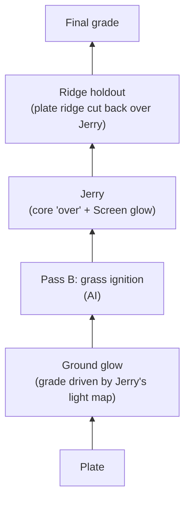

**Created:** 2026-11-02
**Modified:** 2026-11-02
**Version:** 1.0

# Shot004 Fire Jump Comp And Pass B Plan

The plan for turning the shot 004 Pass A element (Jerry on black) into a layered comp over the plate, and for generating the remaining layers. The Pass A test queue and its scores stay in `docs/vfx-element-benchmark.md`; this file covers everything that sits on top of a Pass A element.

## Decisions (2026-11-02, James)

- **Comp tool: Blender first.** The agent builds the comp as a Blender compositor node tree by script, renders a preview, checks it, and hands over a `.blend` that James can open and adjust node by node. Blender 5.2.1 is installed and the Blender MCP bridge is set up (`mcp/blender.md`).
- **Fusion and Resolve later, if needed.** James has DaVinci Resolve Studio 21.1.1, so external scripting is available, and the same comp could be authored as a Fusion graph. Resolve's color tools are the main reason to move there. Final grading may be a separate Resolve step either way.
- **Pass B grass ignition is AI-first.** The production grass-fire render `ren_grassfire_cpu..mov` is a rough first attempt, kept as a timing and behavior reference. It is not the element. The goal is an AI version that looks better.
- **Quick previews** can still be made with `ffmpeg` (Screen blend). Placement math is in `docs/findings.md`, 2026-11-01.

## Current Inputs

| Layer | File | Status |
|---|---|---|
| Plate | `assets/elements/by-shot/shot004_fire-jump/plates/FW_test_scene.mp4` (4096×2160, 24 fps, 84 frames, 10-bit) | Staged test plate; its provenance relative to the original `4 base plate.mov` is unverified. |
| Jerry (Pass A) | `assets/elements/by-shot/shot004_fire-jump/benchmark/shot004_fire-jump_mick13-skyreels_graymask-promptv3-jb010-str125-lenovo_seed1218565630_v001.mp4` (run 8, 912×512, 24 fps, 81 frames) | Current best. Too large (see below). |
| Houdini fire (reference) | `assets/elements/by-shot/shot004_fire-jump/fire/shot004_fire-jump_ren-small-fire6_source_v001.mov` (decodes 1920×1014, covers the whole plate) | Motion source for Pass A. |
| Grass fire (reference only) | `ren_grassfire_cpu..mov` on the NAS backup | Not restored. |
| Delivered comp (reference) | `Shot4 V031-1.mov` on the NAS backup | Not restored. |

Placing a Mick 1.3 512p clip on the plate scaled to 1920×1014: scale ×2.0192 to 1842×1034, crop 10 px off the top, place at x +39.

## Layer Stack

Every layer is a separate input or node, so Jerry, the grass fire, or the glow can be swapped or regenerated without rebuilding the rest (the shot plan's core rule).

## Layers: Method And Status

### Jerry (Pass A element)

- Review of run 8 over the plate (2026-11-01): placement and black are correct; Jerry reads as a pale glowing orb and slightly translucent; he is 20–50% larger than the Houdini fire.
- **Size:** rebuild the gray-in-mask guide with about 4–8 px of growth and a rounded top (benchmark step 8c, item 4). Open creative question below about whether Jerry should keep growing after landing.
- **Translucency:** comp first. Use an opacity matte from Jerry's bright core comped "over" the plate, plus a Screen or Add copy for the glow, plus a hotter grade. Generation fallback: prompt for a denser, brighter core, or NAG negatives.
- Remaining GPU tests are in benchmark step 8c: NAG with negatives, 720p, smaller guide.

### Ridge holdout

At the start position a dirt ridge in front of Jerry should hide part of him, as in the Houdini version. Cut the ridge out of the plate as a foreground matte (hand roto in Blender or Fusion, or AI segmentation such as SAM2) and layer it back over Jerry. Comp only.

### Ground glow

A comp effect, not AI. Take Jerry's element brightness, blur it heavily and tint it orange, and use that light map to brighten and warm the plate where the light falls, limited by a soft ground mask with a strength control. It moves and flickers with Jerry automatically. Upgrade path if it looks flat: a rough ground surface in Blender with a point light following Jerry's path, rendered as a light pass.

### Pass B: grass ignition (AI)

What it must do: ignition starts where and when Jerry lands, spreads through the grass, and the flame grows with the grass catching, not as Jerry inflating. Checks, as in the benchmark: ignition starts at the landing frame, stays inside the grass region, plate intact outside it.

Candidates, cheapest and most controllable first:

1. **AI enhancement of the production grass-fire render.** Feed `ren_grassfire_cpu` as the VACE driving video with flame references and a photographic-flame prompt, on black. Pass A run 1 showed that an RGB driving video is traced almost exactly. That was a failure for Jerry, but here it keeps the production timing and shape while the model replaces the texture. Output is an element on black for Screen or Add, like Jerry. Needs the render restored from the NAS.
2. **Inpainting on the clean plate.** Mick 1.3's native mode: DRIVING VIDEO = the clean plate, MASK = the grass region, animated to start at the landing spot on the landing frame and spread outward, prompt for dry grass catching fire, match mode "Compose + Match", which keeps the plate outside the mask and fixes the colour seam. Use the clean plate, never the plate with Jerry comped in, or the model redraws Jerry and bakes him into the grass layer. Can also scorch and blacken the grass, which an element on black cannot. Caution: the first stock-VACE plate test (2026-10-08) failed with colour artefacts and a growing static mask; Mick's animated-mask setup is different but expect iteration.
3. **Loose flame and smoke elements** from Wan-Alpha (text-to-video with real alpha), comped by hand as extra detail. Parked in the benchmark until 1 or 2 is scored.

Smoke or heat distortion and scorch are listed in the shot plan's required layers. Scorch comes free with candidate 2; heat distortion is a comp effect.

## Files To Fetch From The NAS

James will copy these when he is at the NAS. Put them in `assets/inbox/`; they are classified and renamed from there. NAS restore prefix: `/Volumes/FW_Backup/Robs-Mac-Studio.local/Volumes/Rob's 4tb FAST/`.

| Priority | NAS path (under the prefix) | Use |
|---|---|---|
| 1 | `04 VFX/VFX Footage/Shot_4/shot_4v031_delivery/ren_grassfire_cpu/` (Proxy `.mov`; any EXR or full-res frames too) | Pass B reference and the input for candidate 1 |
| 1 | `04 VFX/VFX Footage/Shot_4/shot_4v031_delivery/Proxy/Shot4 V031-1.mov` | The delivered comp: ignition timing, occlusion, glow reference |
| 2 | The original base plate (`4 base plate.mov`); exact NAS location not yet recorded, likely under `04 VFX/VFX Footage/Shot_4/` | The real plate for the final comp |
| 3 | `.../shot_4v031_delivery/ren_steam/` and `.../ren_wetmap/` | Smoke and scorch reference |

## Open Questions For James

- After landing, should Jerry himself keep roughly the same size while the growth comes from the grass catching? If yes, the new guide holds his size steady after landing.
- Ignition frame: confirm against `Shot4 V031-1.mov` once restored.

## Order Of Work

Not GPU-bound:

1. Build the smaller, rounded guide and mask (local, free).
2. Build the first Blender comp with what is on hand: plate, run 8, ridge holdout, ground glow. Render a preview for review and hand over the `.blend`.
3. When the NAS files arrive: restore and index them, then compare with the delivered comp.

GPU, once RunPod `CA-MTL-1` is back (down since 2026-10-31; see `mcp/runpod.md`):

4. Pass A, benchmark step 8c: smaller guide with run 8's settings, NAG with negatives, 720p.
5. Pass B: candidate 1 (needs the grass-fire render), then candidate 2.
6. Swap the winners into the Blender comp; final grading in Resolve if wanted.

Ideas for later shots (hand-drawn paths, motion from Blender or After Effects, compositing in Blender, inpainting) are in `references/mickmumpitz-library.md` under Creature on a Path.

---

## Changelog

| Version | Date       | Description |
|---------|------------|-------------|
| 1.0     | 2026-11-02 | Initial Shot004 Fire Jump Comp And Pass B Plan. |
