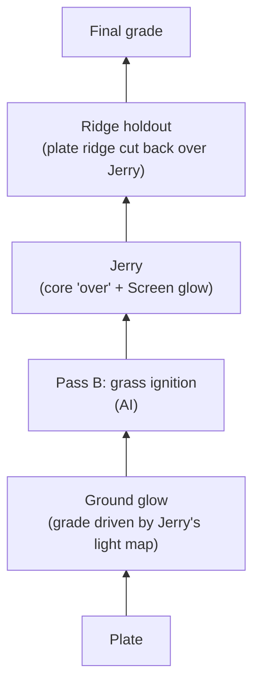

**Created:** 2026-11-02
**Modified:** 2026-11-03
**Version:** 1.15

# Shot004 Fire Jump Comp And Pass B Plan

The plan for turning the shot 004 Pass A element (Jerry on black) into a layered comp over the plate, and for generating the remaining layers. The Pass A test queue and its scores stay in `docs/vfx-element-benchmark.md`; this file covers everything that sits on top of a Pass A element.

## Decisions (2026-11-02, James)

- **Comp tool: Blender first.** The agent builds the comp as a Blender compositor node tree by script, renders a preview, checks it, and hands over a `.blend` that James can open and adjust node by node. Blender 5.2.1 is installed and the Blender MCP bridge is set up (`mcp/blender.md`).
- **Fusion and Resolve later, if needed.** James has DaVinci Resolve Studio 21.1.1, so external scripting is available, and the same comp could be authored as a Fusion graph. Resolve's color tools are the main reason to move there. Final grading may be a separate Resolve step either way.
- **After the side-by-side (2026-11-02): stay in Blender for now.** It renders about four times faster and is simpler to rebuild by script. The Fusion version is kept for reference (see Fusion Comp v001); Resolve stays the likely place for the final grade.
- **Pass B grass ignition is AI-first.** The production grass-fire render `ren_grassfire_cpu..mov` is a rough first attempt, kept as a timing and behavior reference. It is not the element. The goal is an AI version that looks better.
- **Quick previews** can still be made with `ffmpeg` (Screen blend). Placement math is in `docs/findings.md`, 2026-11-01.

## Current Inputs

| Layer | File | Status |
|---|---|---|
| Plate | `assets/elements/by-shot/shot004_fire-jump/plates/FW_test_scene.mp4` (4096×2160, 24 fps, 84 frames, 10-bit) | Staged test plate; its provenance relative to the original `4 base plate.mov` is unverified. |
| Jerry (Pass A) | `assets/elements/by-shot/shot004_fire-jump/benchmark/shot004_fire-jump_mick13-skyreels_graymask-promptv3-jb010-str125-lenovo_seed1218565630_v001.mp4` (run 8, 912×512, 24 fps, 81 frames) | Current best. Too large (see below). |
| Houdini fire (reference) | `assets/elements/by-shot/shot004_fire-jump/fire/shot004_fire-jump_ren-small-fire6_source_v001.mov` (decodes 1920×1014, covers the whole plate) | Motion source for Pass A. |
| Grass fire (reference only) | `ren_grassfire_cpu..mov` on the NAS backup | Not restored. |
| Delivered comp (reference) | `assets/elements/by-shot/shot004_fire-jump/comps/Shot4 V031-1.mp4` (1920×1080, 24 fps, 84 frames) | Local copy, file-dated 2026-10-08; its relation to the NAS `Shot4 V031-1.mov` is unverified. Ignition timing below. |
| Comp (Blender) | `assets/elements/by-shot/shot004_fire-jump/comps/shot004_fire-jump_comp-blender_run8_v001.blend` | v001, 2026-11-02. See Blender Comp v001. |

Placing a Mick 1.3 512p clip on the plate scaled to 1920×1014: scale ×2.0192 to 1842×1034, crop 10 px off the top, place at x +39.

## Layer Stack



Every layer is a separate input or node, so Jerry, the grass fire, or the glow can be swapped or regenerated without rebuilding the rest (the shot plan's core rule).

## Layers: Method And Status

### Jerry (Pass A element)

- Review of run 8 over the plate (2026-11-01): placement and black are correct; Jerry reads as a pale glowing orb and slightly translucent; he is 20–50% larger than the Houdini fire.
- **Size:** rebuild the gray-in-mask guide with about 4–8 px of growth and a rounded top (benchmark step 8c, item 4). **Growth after landing (James, 2026-11-02):** Jerry grows slightly as the grass catches and grows with him. He should not inflate the way the Houdini fire does: its area roughly triples from landing to the last frame, about 1.7× in linear size. Build the guide at the Houdini fire's size up to landing, then damp the post-landing growth to about 1.2–1.3× linear by the last frame. Make the factor a setting in the guide builder so it can be tuned after a test, and time it to the grass ignition so Jerry and the grass grow together.
- **Guide builder (2026-11-02):** `scripts/build_shot004_guide.py`, run with `/usr/local/bin/python3` (numpy, OpenCV). Per frame: red channel > 20, holes filled; an opening with a 14 px disk removes flame tongues and the tip; the largest piece is replaced by its convex hull; after scaling, a second opening at 0.3 × the body's smaller side domes the top; then 6 px of growth. Up to frame 28 (bottom settles on the ground) the body keeps the fire's size. After it, width and height each follow the fire's own growth raised to one exponent, so the body's linear size (√(w·h)) reaches `--post-scale` at `--grow-end` and keeps the fire's timing. Measured on the rounded body, the fire grows 1.91× from frame 28 to 80; at 1.25 the exponent is 0.346 and the body grows 1.24×. Settings: `--grow`, `--round`, `--round-frac`, `--landing`, `--post-scale`, `--grow-end` (default the last frame; set it nearer frame 48–54 to finish growing with the grass), `--soft` (mask edge, sigma 3 as before). Each run writes the guide, the mask, and a JSON report of the settings and per-frame sizes.
- **Default candidate, awaiting James's approval** (in `outputs/shot004/pass-a_jerry/guide_v002/candidates/`, not yet an asset): `grow6-round14-30-post125`. Against the grow16 guide it is 0.83× linear at frame 0, 0.80× at landing, and 0.60× by frame 80. Against the fire mask it is 1.16× at frame 0 (6 px of growth on a small body), 1.09× at landing, and 0.73× at frame 80, where the fire is a tall column. Variants built for comparison: `grow4`, `grow8`, `post120`, `post130`, and `round-frac 0`. Previews: `outputs/shot004/pass-a_jerry/guide_v002/guide_v002_outlines_a.png`, `guide_v002_fill_a.png`, `guide_v002_on-run8_a.png`, `guide_v002_preview_v001.mp4`. On approval it is copied into `fire/` under its `_v001` name, indexed in `docs/asset-inventory.md`, and uploaded to the volume's `input/`. The GPU run then changes one input, the guide, but that input changes size, top shape, and post-landing growth together; if the result is mixed, the variants separate them.
- **Translucency:** comp first. Use an opacity matte from Jerry's bright core comped "over" the plate, plus a Screen or Add copy for the glow, plus a hotter grade. Generation fallback: prompt for a denser, brighter core, or NAG negatives. Done in Blender Comp v001; it exposed a face problem in run 8 (see below).
- Remaining GPU tests are in benchmark step 8c: NAG with negatives, 720p, smaller guide.

### Ridge holdout

At the start position a dirt ridge in front of Jerry should hide part of him, as in the Houdini version. Cut the ridge out of the plate as a foreground matte (hand roto in Blender or Fusion, or AI segmentation such as SAM2) and layer it back over Jerry. Comp only. Done in Blender Comp v001 as a hand-placed mask.

### Ground glow

A comp effect, not AI. Take Jerry's element brightness, blur it heavily and tint it orange, and use that light map to brighten and warm the plate where the light falls, limited by a soft ground mask with a strength control. It moves and flickers with Jerry automatically. Upgrade path if it looks flat: a rough ground surface in Blender with a point light following Jerry's path, rendered as a light pass. Done in Blender Comp v001.

### Pass B: grass ignition (AI)

What it must do: ignition starts where and when Jerry lands and spreads through the grass. Most of the growth in flame comes from the grass catching; Jerry grows only slightly with it (see Size above). Checks, as in the benchmark: ignition starts at the landing frame, stays inside the grass region, plate intact outside it.

Candidates, cheapest and most controllable first:

1. **AI enhancement of the production grass-fire render.** Feed `ren_grassfire_cpu` as the VACE driving video with flame references and a photographic-flame prompt, on black. Pass A run 1 showed that an RGB driving video is traced almost exactly. That was a failure for Jerry, but here it keeps the production timing and shape while the model replaces the texture. Output is an element on black for Screen or Add, like Jerry. Needs the render restored from the NAS.
2. **Inpainting on the clean plate.** Mick 1.3's native mode: DRIVING VIDEO = the clean plate, MASK = the grass region, animated to start at the landing spot on the landing frame and spread outward, prompt for dry grass catching fire, match mode "Compose + Match", which keeps the plate outside the mask and fixes the colour seam. Use the clean plate, never the plate with Jerry comped in, or the model redraws Jerry and bakes him into the grass layer. Can also scorch and blacken the grass, which an element on black cannot. Caution: the first stock-VACE plate test (2026-10-08) failed with colour artefacts and a growing static mask; Mick's animated-mask setup is different but expect iteration.
3. **Loose flame and smoke elements** from Wan-Alpha (text-to-video with real alpha), comped by hand as extra detail. Parked in the benchmark until 1 or 2 is scored.
4. **MiniMax H3 inpainting** (found 2026-11-02). H3 is the open-weight video model Mickmumpitz built his 2026-10-28 short film on; his Performance Capture 2.2 and AI renderer graphs also use it. It generates 5–15 s in one pass at a native 1344×768 and inpaints video through a mask with its Fun ControlNet Union patch (ComfyUI 0.35+, Union 2.0 0.38+; the `EU-RO-1` Pod runs 0.30.0). Its minimum length is 5 s (124 frames), so the 84-frame shot would be padded and trimmed. Local commercial use needs a paid MiniMax license through Comfy; Comfy Cloud generations include commercial rights, and Comfy Cloud already has the H3 nodes and models, so the first H3 test can run there with the same plate crop and mask as candidate 2.

#### Candidate 2 setup, test 1 (2026-11-02)

Inputs from `scripts/build_shot004_grassfire_inputs.py`, saved in `assets/elements/by-shot/shot004_fire-jump/scorch-contact/` (`_v001`, with a JSON report of the settings):

- **Window.** A 1824×1024 window of the 4096×2160 plate, top-left at plate (1838, 488), scaled ×0.5 to 912×512. Inpainting this window instead of the whole frame keeps twice the detail: the result goes back on the plate at ×2, where a full-frame 512p run would need ×4.3. It holds the grass clump and Jerry from the landing on.
- **Mask** (`…_mask-start25-full50-soft_…`). Empty to frame 24. From frame 25, when Jerry touches down, it spreads from his landing contact (window pixel 490, 450) through a burn zone, the grass clump and the air above it, and covers it by frame 50, then holds to the end. It climbs faster than it spreads sideways, its front and outline are irregular, and it stays 24 px inside the window, so flames never meet the window's edge where the inpaint joins the untouched plate. About 53% of the window at full spread. Timing, spread curve, climb and raggedness are settings.
- **DRIVING VIDEO** (`…_control-plate-canny-start25-full50_…`). The plate outside the mask; inside it, the plate's Canny edges on black. This is Mickmumpitz's recipe from his OfficeFlood example (`MICKMUMPITZ_AIVFX_EXAMPLE-FILES.zip`, `010_OfficeFlood`): the blade edges keep the grass's structure while the model draws fire into it.
- **Start image** (`…_start-frame_…`): the window's frame 0, the plate before any fire. Not committed: plate stills are ignored like the plate.

Graph: `workflows/comfyui/shot004-working/pass-b_grassfire/shot004_fire-jump_grassfire-inpaint_mick13_v001.json`, on the Pod as `shot004/pass-b_grassfire/`. It is the Jerry graph (run 9 state) with these changes: the three inputs above; Reference Image 2 (`JB-010`) bypassed; image mode `Start + Reference` and match mode `Compose + Match`; `vace_strength` 1.0 and `vace_ref_strength` 0, as in the OfficeFlood run; a grass-fire prompt with `l3n0v0`; the NAG negatives swapped from face words to "cartoon, CGI, animation, fireball, glowing orb, character, face, text, watermark"; output prefix `shot004_grassfire`. Seed, steps, sampler, LoRAs, 512p and 81 frames are unchanged. Because this is the first run of a new graph, it is a baseline, not a one-knob test.

#### Pass B test log

Kept clips are in `assets/elements/by-shot/shot004_fire-jump/benchmark/` and graph extracts in `workflows/comfyui/shot004-benchmark/`, both named `shot004_fire-jump_grassfire-inpaint_mick13_test<N>_…`. Measures: fire pixels (bright, red-dominant) as a share of the window and of the mask; the share of the fire that run 9's Jerry would cover; and the mean change outside the mask.

| Date | Test | Change | Time | Ignition | Fire size and place | Plate outside mask | Look | Next |
|---|---|---|---|---|---|---|---|---|
| 2026-11-02 | 1 | New graph: inputs v001, settings above | 610 s (L4) | Pass. A spark at Jerry's landing contact on frame 26, spreading from frame 28 | Fail. A Jerry-sized fire at the base of the clump: at most 7.5% of the window and 11–14% of the mask; the rest of the mask was redrawn as grass. 56–100% of the fire sits where Jerry is, so he would hide most of it | Pass outside, fail at the edge. Outside: ~2/255, the re-encode level; 7 fire pixels in 81 frames. Inside, the redrawn grass is darker than the plate (luma −8 to −13 from 2 to 60 px inside the edge on frame 80), so the mask outline shows as a dark ring (James); Compose + Match did not correct it | Mixed. Flames weave through the blades, with blades in front and a scorched base, and the window blends into the plate with no visible seam. But the flames are saturated, hard-edged and sticker-like, with no smoke and no spread up the blades, and their colour does not match Jerry | prompt rewrite (below) |
| 2026-11-02 | 2 | Test 1 plus `JB-010` as Reference Image 2 (James), `vace_ref_strength` still 0 | 647 s (L4) | Pass, same as test 1 | Fail, ≈ test 1: 1.7–6.8% of the window, 59–84% of it under Jerry. A different sample after ignition (PSNR 19–25 dB against test 1, 43 dB or more before frame 25), not a style change | Pass outside; the same dark ring | Same sticker-like flames; a bluish-white smoke puff at the base late in the shot | With `vace_ref_strength` 0 an added reference only reshuffles the sample. To pass style it needs a strength above 0, which risks Jerry's shape. Back to test 1's state for the prompt rewrite |
| 2026-11-03 | 3 | Test 1 with the prompt rewrite (whole clump engulfed, tall flames, smoke, Jerry's flame words); `JB-010` bypassed. On an A100, so not seed-for-seed comparable with tests 1–2 | 280 s (A100) | Pass | Fail, a little better: 0.9–6.4% of the window, 11–13% of the mask; wider, two-lobed flames, so less of it under Jerry (42–76%). Climbs higher early (top row 90 vs 123 on frame 40) but not by the end. 107 fire pixels outside the mask | Pass outside; the dark ring is unchanged (−10.6 and −12.8 luma inside the edge on frames 50 and 80) | Brighter, whiter flames, close to Jerry's average colour (fire pixels RGB 239/177/95 against Jerry's 224/158/93), but hard-edged and cut-out, not soft and translucent like Jerry. The blades stay intact thin dark lines in front of the flames: the fire sits behind the grass instead of the grass burning (James) | loosen the edges inside the mask |
| 2026-11-03 | 4 | Test 3 with `vace_strength` 1.0 → 0.6 (same A100) | 191 s (A100) | Pass | Fail, better: from frame 50 the fire is 8–9% of the window and 15–17% of the mask (test 3: 6% and 11–12%), still 54–77% under Jerry. A different sample (PSNR 13–15 dB against test 3). Inside the mask the grass follows the plate's edges less (edge agreement 0.24–0.28 against 0.33–0.36) | Pass outside; the dark ring is unchanged (−11.8 and −12.7 luma) | Fuller flames, but still cut-out, and the blades are still dark lines in front of them. James: not much different | gray inside the mask, or a keyframe in the control video |
| 2026-11-03 | 5 (repeat) | Meant as gray inside the mask, but the DRIVING VIDEO loader still pointed at the Canny control, so the graph was test 4's exactly | 190 s (A100) | — | Every frame pixel-identical to test 4 (max difference 0) | — | — | Not kept. It shows that on one GPU type and install a rerun reproduces exactly, so one-knob A/B on the A100 is exact. Rerun as test 6 with the gray control |

Fix for the dark ring, in the comp rather than the generation: take from the inpaint only what changed. A change matte (per-pixel difference from the plate window, ramped from 22 to 45 of 255, grown 6 px, blurred 6 px, times the mask) keeps the fire, the scorch and the blades in front of the fire, and drops grass the model merely redrew darker. On frames 50 and 80 it cut the darkening in the band 2–60 px inside the edge from −12.7 and −11.0 to −1.9 and −1.8 luma. The Blender comp's Pass B layer should use it.

Reading of test 1: the prompt asked for "a small flame" that "spreads", and inside the mask the Canny edges tell the model exactly where grass blades are, at `vace_strength` 1.0, so it redrew grass and kept the fire small. Edges can show structure; they cannot ask for fire. Next tests, one change each, cheapest first:

1. **Prompt** (test 3, ready to run; `JB-010` bypassed again, prompt below). Drop "small flame"; describe the whole clump engulfed, with tall flames climbing above the blades and grey smoke, in Jerry's flame vocabulary (soft translucent flames, peach-white heart, orange and gold tongues, thin dark smoke, sparks) so the two fires match.
   Test 3 prompt: "l3n0v0, A fire suddenly ignites at the base of the grass clump and within a second engulfs the whole clump of dry grass. Tall flames climb up every blade and rise high above the tips, with grey smoke curling upward and glowing embers drifting in the air. The flames are soft and translucent, with a bright peach-white glow at the heart and orange and gold flame tongues licking upward, thin dark smoke wisps and tiny sparks. Grass blades blacken and curl as they burn. Realistic outdoor fire in natural daylight, filmed with a real camera."
2. **Inside the mask.** Canny edges replaced by flat gray, or `vace_strength` lowered, to loosen the hold on the grass.
3. **Taller window, 720p** (input set v002): a window from the frame top so the mask can reach the grass tips. Only useful once the fire fills the current mask.
4. **Styled reference still**, as in Mickmumpitz's OfficeFlood run: a plate frame with burning grass painted in by an image model, given Jerry's flames as the style.
5. **The production grass-fire render as the guide** (candidate 1) once it is restored from the NAS: it would tell the model where and how big the fire is.

Smoke or heat distortion and scorch are listed in the shot plan's required layers. Scorch comes free with candidate 2; heat distortion is a comp effect.

## Blender Comp v001 (2026-11-02)

`assets/elements/by-shot/shot004_fire-jump/comps/shot004_fire-jump_comp-blender_run8_v001.blend`, built by `scripts/blender/shot004_comp_build.py` (Blender 5.2.1). Rebuild with:

```sh
/Applications/Blender.app/Contents/MacOS/Blender -b --factory-startup \
  --python scripts/blender/shot004_comp_build.py -- assets/elements/by-shot/shot004_fire-jump/comps/shot004_fire-jump_comp-blender_run8_v001.blend
```

Rebuilding overwrites the file, so save hand edits as `_v002` first. Starting values are in the script's `LOOK` table; every tunable node is labelled `CTRL …`. 4096×2160 at 100%, frames 1–81 (Jerry's length; the plate has 84). Frame 1 is plate frame 0 and run 8 frame 0. Renders at about 2 s per frame on the M2 Pro GPU. To inspect one node, `scripts/blender/comp_tap.py` renders its output to EXR without saving the `.blend`.

| Layer | Nodes and starting values |
|---|---|
| Plate | Image node, movie, 84 frames. View transform Standard. |
| Ground glow | Jerry luminance → Fast Gaussian blur 900 px → map range 0–0.08 to 0–1 → × tint (1.0, 0.42, 0.10). Lit plate = plate × (1 + 2.5 × tint × light), limited by mask `ground_glow_limit` (row 500 down to the ridge, blurred 220 px), so the ridge's camera side stays dark. Raises the dirt under Jerry about 1.6–2.4× in red. |
| Pass B slot | A reroute (`Pass B in`) between the lit plate and Jerry; insert the grass ignition there. |
| Jerry | Run 8 → Transform ×4.3077 about the centre, bicubic (the 2026-11-01 placement math; the compositor centres images, so no offset) → saturation 1.2 → gain (1.25, 1.0, 0.78) → dark-patch fill (Lighten with a 140 px blur of itself, amount 1.0). Core over: matte = luminance blurred 30 px, mapped 0.03–0.22 to 0–1, × opacity 0.85. Then the same Jerry Screened on top, plus Fog Glow bloom (threshold 0.25, strength 0.6). |
| Ridge holdout | Mask `ridge_holdout`, a polygon along the defocused ridge top (rows 1778–1815 at 4096 wide, traced from the focus fall-off on frame 0; the camera is locked), blurred 28 px; mixes the lit plate back over Jerry. Hides the bottom ~90 px of Jerry at the start, frames 1–12. |
| Final grade | Neutral Color Balance → Group Output and Viewer. |

Review of the full render (`outputs/shot004/comp/blender/shot004_fire-jump_comp-blender_run8_preview_v001.mp4`, 2048×1080):

- Placement matches the ffmpeg preview within a few pixels on frames 1 and 33. Jerry now reads as hot and opaque, and the ground glow gives a warm pool on the dirt and grass that follows him without visible flicker (the largest frame-to-frame change in a ground patch is 2.7 of 255, during the jump).
- **Face problem in run 8.** Once Jerry is opaque and hot, the darker interior patches of run 8 read as two eyes and a mouth on about frames 45–70. Over the plate with Screen alone they read as pale cloud, which hid this. The dark-patch fill reduces it but does not remove it, and it softens the flame texture. This is a generation problem, and the reason to run benchmark step 8c item 1 (NAG negatives "face, eyes, nose, mouth") before trusting a look; the smaller guide may also change it.
- A thin blue-violet line sits along Jerry's bottom edge on some frames after landing (visible at frames 49 and 65).
- Blender's movie decode of the plate is about 1.5–2 of 255 brighter than ffmpeg's `rgb24` conversion across the frame. It is a decode difference, not a comp change; compare comps against Blender's own plate.

Blender 5.2 compositor details that cost time: the comp is `scene.compositing_node_group`, a node group with an Image output (there is no Composite node); the render percentage does not scale image inputs, so render at 100%; the Mix node clamps its factor to 0–1 unless `clamp_factor` is off; mask coordinates are x = px / width and y = (height / 2 − row) / width + 0.5.

## Fusion Comp v001 (2026-11-02)

James asked for the same comp in DaVinci Resolve Studio's Fusion page to compare the two tools. Built by `scripts/resolve/shot004_comp_fusion.py` through Resolve's scripting interface (External scripting = Local), run with Resolve's bundled Python:

```sh
"/Applications/DaVinci Resolve/DaVinci Resolve.app/Contents/Applications/ResolvePython" \
  scripts/resolve/shot004_comp_fusion.py \
  --setting assets/elements/by-shot/shot004_fire-jump/comps/shot004_fire-jump_comp-fusion_run8_v001.setting \
  [--render-preview DIR --frames 0-80]
```

- **Where it lives:** Resolve project `FW_AI_shot004_comp` (Local Database; it was "New Project 4"), project and timeline at 4096×2160, 24 fps. Timeline `shot004_comp_v001` has the plate on V1 and run 8 on V2, turned into one Fusion clip, so MediaIn1 is the plate and MediaIn2 is Jerry. The node tree is also saved as `assets/elements/by-shot/shot004_fire-jump/comps/shot004_fire-jump_comp-fusion_run8_v001.setting`, which can be pasted into any comp; after pasting, wire MediaIn2 → `Jerry_Place`, MediaIn1 → `Glow_PlateXLight` (Background) and `Glow_Add` (Background), and `Final_Grade` → MediaOut1.
- **Project file in the repo:** `assets/elements/by-shot/shot004_fire-jump/comps/shot004_fire-jump_comp-fusion_run8_v001.drp`, a Resolve project export (File → Import Project in Resolve's Project Manager). It holds the timeline and the Fusion clip with the full node tree; the media are linked by absolute path, so relink if the repo moves.
- **Rerunning the script rebuilds the comp** and deletes every tool except the MediaIns and MediaOut, so hand edits are lost. Before tuning by hand, copy the Fusion clip or the timeline in Resolve.
- **Nodes:** four underlays group the layers (`Layer_Jerry_Element`, `Layer_Ground_Glow`, `Layer_Jerry_Comp`, `Layer_Ridge_Holdout`). Tools are named for their job (`Jerry_Place`, `Jerry_DarkFill`, `Jerry_CoreKey`, `Glow_GroundMask`, `PassB_Slot`, `Ridge_Mask`, `Final_Grade`, and so on), and the two masks are Polyline masks whose points can be dragged in the viewer.
- **Same layers, different maths:** Fusion in Resolve works on the Rec.709 values it receives, not scene linear as Blender's compositor does, so its grade, matte thresholds, and glow strength are separate values, tuned until the two matched. Resolve hands Jerry to Fusion already fitted to the timeline height (×4.21875), so `Jerry_Place` adds only ×1.0213 to reach the same ×4.3077 placement.
- **Match against the Blender comp** (`outputs/shot004/comp/fusion/shot004_fire-jump_comp-fusion_run8_preview_v001.mp4`; side by side in `outputs/shot004/comp/blender-vs-fusion_v001.mp4`): placement matches; ground glow just under Jerry is within about 10% of Blender's (red ×2.0–2.2 against ×2.1–2.4), a little weaker 150 px out; Jerry's body is slightly more yellow; the ridge holdout covers the same area. The dark-patch fill softens the face patches a little more than Blender's, but they still read as a face on frames 45–70.

| | Blender compositor | Fusion page (Resolve) |
|---|---|---|
| Build by script | `bpy`, headless; no app open | Resolve must be open with scripting on; several API traps (see `docs/findings.md`, 2026-11-02) |
| Render, 4096×2160 | ~2 s per frame on the M2 Pro GPU | ~8 s per frame, rendered through a temporary Saver |
| Working space | Scene linear | Rec.709 as received, unless Resolve colour management is set up |
| Masks | Mask editor, a separate editor | Polyline points in the viewer, as in any Fusion comp |
| Grading | Compositor nodes only | Color page on the same clip |
| File in the repo | `.blend`, opens by itself | `.setting` text; the live comp is in the Resolve database |

## Ignition Timing In The Delivered Comp

From the local `Shot4 V031-1.mp4`: the fire lands around frame 23, the grass catches at once, spreads upward and outward through about frame 48, peaks around frames 42–54, and has burned down by about frame 66, while the main fire keeps growing taller to the end. The Houdini source settles on the ground at frames 25–28, so the delivered comp may sit the fire 2–3 frames earlier, or its source differs; confirm against the NAS `.mov` when restored. The delivered comp also carries other elements (a silver shape lower left, smoke near the start), so compare only the fire, grass, and glow.

## Files To Fetch From The NAS

James will copy these when he is at the NAS. Put them in `assets/inbox/`; they are classified and renamed from there. NAS restore prefix: `/Volumes/FW_Backup/Robs-Mac-Studio.local/Volumes/Rob's 4tb FAST/`.

| Priority | NAS path (under the prefix) | Use |
|---|---|---|
| 1 | `04 VFX/VFX Footage/Shot_4/shot_4v031_delivery/ren_grassfire_cpu/` (Proxy `.mov`; any EXR or full-res frames too) | Pass B reference and the input for candidate 1 |
| 2 | The original base plate (`4 base plate.mov`); exact NAS location not yet recorded, likely under `04 VFX/VFX Footage/Shot_4/` | The real plate for the final comp |
| 3 | `04 VFX/VFX Footage/Shot_4/shot_4v031_delivery/Proxy/Shot4 V031-1.mov` | The delivered comp; a local `.mp4` copy already covers timing and glow reference, so this only confirms provenance |
| 3 | `.../shot_4v031_delivery/ren_steam/` and `.../ren_wetmap/` | Smoke and scorch reference |

## Open Questions For James

- ~~After landing, should Jerry keep the same size while the grass carries the growth?~~ Answered 2026-11-02: Jerry grows slightly as the grass catches and grows with him (see Size).
- Ignition frame: the local `Shot4 V031-1.mp4` shows ignition at landing, about frame 23 (see Ignition Timing). Confirm against the NAS `.mov` once restored.
- Guide: approve `grow6-round14-30-post125`, or pick a variant (growth 4 or 8 px, post-landing 1.2 or 1.3, growth ending at the grass peak instead of the last frame).

## Order Of Work

Not GPU-bound:

1. ~~Build the smaller, rounded guide and mask (local, free).~~ Built 2026-11-02; candidate awaiting approval (see Size).
2. ~~Build the first Blender comp with what is on hand: plate, run 8, ridge holdout, ground glow. Render a preview for review and hand over the `.blend`.~~ Blender Comp v001, 2026-11-02.
3. When the NAS files arrive: restore and index them, then compare with the delivered comp.

GPU, on the rebuilt `EU-RO-1` volume (see `mcp/runpod.md`):

4. Pass A, benchmark step 8c: smaller guide with run 9's settings; 720p later.
5. Pass B: candidate 2 test 1 (above), then candidate 1 once the grass-fire render is restored.
6. Swap the winners into the Blender comp; final grading in Resolve if wanted.

Later (James, 2026-11-02), not now:

- Update ComfyUI, either in place with a rollback or as a second install beside the current one. Needed before MiniMax H3 can run on the Pod. Why the Pod runs 0.30.0, and what an update risks, is in `mcp/runpod.md` (ComfyUI version).
- Try MiniMax H3 for the grass fire (candidate 4), probably on Comfy Cloud first.
- A fire-style LoRA (James, 2026-11-02): one trained look for every AI fire in the film, Jerry and grass alike. Train it on fire material (flame close-ups, approved renders, matching real fire), not on whole Jerry bodies, so it carries the look without pulling every fire into his teardrop shape; a Jerry character LoRA stays a separate option (benchmark Stage 4). A LoRA only works on the base model it was trained for, so decide between the Wan 2.1 14B family and MiniMax H3 first, and approve the target look first.

Ideas for later shots (hand-drawn paths, motion from Blender or After Effects, compositing in Blender, inpainting) are in `references/mickmumpitz-library.md` under Creature on a Path.

---

## Changelog

| Version | Date       | Description |
|---------|------------|-------------|
| 1.0     | 2026-11-02 | Initial Shot004 Fire Jump Comp And Pass B Plan. |
| 1.1     | 2026-11-02 | Recorded James's answer: Jerry grows slightly after landing alongside the grass fire. Set the guide's damped post-landing growth target. |
| 1.2     | 2026-11-02 | Built the guide builder and a candidate smaller guide (awaiting approval), built Blender Comp v001 with ground glow and ridge holdout, recorded the face problem the opaque comp exposes in run 8, and recorded the local delivered comp copy and its ignition timing. |
| 1.3     | 2026-11-02 | Built Fusion Comp v001 in Resolve Studio from the same layers and geometry and compared it with Blender Comp v001. |
| 1.4     | 2026-11-02 | Recorded the decision to stay in Blender for now, and the Resolve project export `.drp`. |
| 1.5     | 2026-11-02 | Added MiniMax H3 inpainting as Pass B candidate 4. |
| 1.6     | 2026-11-02 | Recorded the grass-fire inpaint inputs and graph for candidate 2 test 1, and James's notes for later: a ComfyUI update or second install, and MiniMax H3. |
| 1.7     | 2026-11-02 | Added James's fire-style LoRA idea to the later list. |
| 1.8     | 2026-11-02 | Scored Pass B candidate 2 test 1 and listed the next tests. |
| 1.9     | 2026-11-02 | Recorded the dark ring along the mask edge in test 1 and the change-matte fix for the comp. |
| 1.10    | 2026-11-02 | Scored Pass B test 2 (`JB-010` added at reference strength 0). |
| 1.11    | 2026-11-02 | Recorded the test 3 prompt for the next session. |
| 1.12    | 2026-11-03 | Scored Pass B test 3 (prompt rewrite, A100). |
| 1.13    | 2026-11-03 | Scored Pass B test 4 (`vace_strength` 0.6). |
| 1.14    | 2026-11-03 | Logged test 5: an unchanged rerun of test 4, pixel-identical. |
| 1.15 | 2026-11-03 | Updated `outputs/` paths to the per-shot layout (`outputs/<shot>/<pass or comp>/`). |
